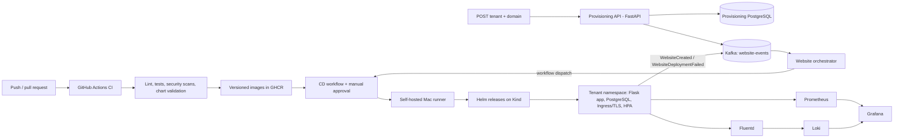

# Yotta multi-tenant website platform

A platform that gives every customer (tenant) an isolated website on Kubernetes: its own namespace,
Flask app, private PostgreSQL, HTTPS host, autoscaling and quotas. A website is requested through an API,
the request travels through Kafka, and GitHub Actions deploys it with Helm onto a local Kind cluster.

## Deliverables at a glance

| Assignment item | Where it is | Proof |
|---|---|---|
| Tenants `user1`–`user3` in separate namespaces | `helm/website-helm/` (one Helm release per tenant) | [proof §1](docs/proof-of-work.md#1-multi-tenant-websites-deployed) |
| HTTPS Ingress per tenant, custom domains without cluster changes | `helm/website-helm/templates/ingress.yaml`, cert-manager issuer in `helm/cluster-addons/cluster-issuer/` | §1 (`user4` via the API) |
| Probes, requests/limits, network policies | `helm/website-helm/templates/deployment.yaml`, `networkpolicy.yaml` | §1 isolation check |
| Sample website in Flask | `services/website/` (Flask + gunicorn) | CI unit tests |
| HPA (CPU + memory), quotas, PDB | `helm/website-helm/templates/hpa.yaml`, `resourcequota.yaml`, `limitrange.yaml`, `pdb.yaml` | [proof §2](docs/proof-of-work.md#2-scaling-under-load) |
| Load simulation | `scripts/load-test.py` | §2 |
| CI: build, test, scan, publish images | `.github/workflows/*_ci.yml`, shared `reusable-service-ci.yml` | [proof §3](docs/proof-of-work.md#3-cicd-with-rollback-and-events) |
| CD with approval, rollback on failure | `.github/workflows/*_cd.yml`, `scripts/deploy-tenant.sh`, [docs/rollback.md](docs/rollback.md) | §3 (`simulate_failure` run) |
| Multiple branches / users | CI on `master`, `feature`, `feature/**`; tenant and domain are inputs | workflow files |
| Single-node Kafka, deployment events | `helm/kafka-helm/templates/kafka.yaml`, `services/website-orchestrator/` | [proof §4](docs/proof-of-work.md#4-kafka-integration) |
| Prometheus / Grafana dashboards, logs in Loki | `helm/monitoring/`, `helm/monitoring/grafana-dashboards/`, `helm/logging-helm/` (Loki, Fluentd) | [proof §5](docs/proof-of-work.md#5-observability-dashboards) |
| Extra: AIOps for failing pods (Grok) | `aiops-pod-doctor/` | its README |

Collect all text evidence with `./scripts/collect-proof.sh`; screenshots are listed in [docs/proof-of-work.md](docs/proof-of-work.md).

## Architecture



| Component | Namespace | Chart / code |
|---|---|---|
| Tenant website (data in the platform database) | `<tenant>` | `helm/website-helm`, `services/website` |
| Provisioning API (users, website requests) | `platform` | `helm/hosting-platform-helm`, `services/hosting-platform` |
| Website orchestrator (Kafka consumer, starts deployments and teardowns) | `platform` | `helm/website-orchestrator-helm`, `services/website-orchestrator` |
| Kafka, kafka-exporter | `platform` | `helm/kafka-helm` |
| Loki, Fluentd (logs) | `observability` | `helm/logging-helm` |
| Grafana dashboards | `observability` | `helm/monitoring/grafana-dashboards` |
| Prometheus, Grafana | `observability` | `helm/monitoring` (kube-prometheus-stack values) |
| Ingress-NGINX, cert-manager, Calico, metrics-server (upstream charts) + ClusterIssuer | cluster | `helm/cluster-addons` (calico-crds, cluster-issuer), `scripts/deploy-cluster-addons.sh` |
| AIOps pod doctor | `aiops` | `aiops-pod-doctor/` |
| Platform database `myyotta_platform` (PostgreSQL 16: users, websites, domains, deployments, configs, events) | `platform-data` | `helm/database-helm` (release `myyotta-postgresql`, Service `postgresql`), `services/database` ([details](services/database/README.md)) |

## Repository layout

```
services/            website (Flask), hosting-platform (FastAPI), website-orchestrator (Kafka consumer)
helm/                <service>-helm charts: website-helm (per tenant), hosting-platform-helm,
                     website-orchestrator-helm, database-helm, kafka-helm, logging-helm (with image/: the Fluentd image);
                     monitoring (Prometheus/Grafana values + grafana-dashboards), cluster-addons (calico-crds, cluster-issuer)
.github/workflows/   one CI and one CD workflow per component, shared reusable-service-ci.yml
scripts/             local setup, tenant deploy with rollback, load test, evidence collection
kind/                Kind cluster definition (ports 8080/8443 on the Mac)
aiops-pod-doctor/    extra: failing-pod analysis with Grok
docs/                deployment, architecture, rollback, proof of work
```

## Deployment steps

### Option A: everything locally in one command

Needs a Docker engine (Colima or Docker Desktop), Kind, kubectl, Helm 4.x and Python 3.12+ on the Mac.
With Colima: `brew install colima docker kind kubectl helm`. The setup scripts start Colima if it is stopped
(4 CPU, 8 GiB memory, 60 GiB disk; change with `COLIMA_CPU`, `COLIMA_MEMORY`, `COLIMA_DISK`), switch the docker CLI
to the `colima` context, and raise the VM's inotify limits that a two-node Kind cluster needs.

```sh
./scripts/setup-local-e2e.sh          # Kind cluster, add-ons, monitoring, platform, provisioning API, user1-3
```

Then add the hosts entry it prints:

```text
127.0.0.1 api.myyotta.com user1.myyotta.com user2.myyotta.com user3.myyotta.com grafana.myyotta.com prometheus.myyotta.com alertmanager.myyotta.com
```

### Option B: through GitHub Actions (the CI/CD path)

One-time setup:

1. Register the Mac as a self-hosted runner with label `yotta-local-k8s` ([docs/local-runner.md](docs/local-runner.md)).
2. Add the repository secret `ORCHESTRATOR_GITHUB_TOKEN`: a fine-grained token with **Actions: Read and write**,
   used by the orchestrator to start deployments (`gh secret set ORCHESTRATOR_GITHUB_TOKEN`).
3. Create the approval environments: `./scripts/setup-deployment-approvals.sh`.

Deploy, in this order, each with the image tag shown on its CI run summary (approve each run):

```sh
gh workflow run platform_cd.yml             --ref master -f image_tag=<platform CI tag>
gh workflow run website_orchestrator_cd.yml --ref master -f image_tag=<orchestrator CI tag>
gh workflow run hosting_platform_cd.yml --ref master -f image_tag=<provisioning CI tag>
```

### Request a website

```sh
curl -k -X POST https://api.myyotta.com:8443/api/v1/users/register \
  -H 'Content-Type: application/json' \
  -d '{"username":"alice","email":"alice@example.com","password":"correct-horse-1"}'   # once: the owner
curl -k -i -X POST https://api.myyotta.com:8443/api/v1/websites \
  -H 'Content-Type: application/json' \
  -d '{"tenant":"user4","domain":"user4.myyotta.com","email":"alice@example.com"}'
curl -k https://api.myyotta.com:8443/api/v1/users                          # all registered users
curl -k https://api.myyotta.com:8443/api/v1/websites                       # all websites and their status
curl -k -i -X DELETE 'https://api.myyotta.com:8443/api/v1/websites?tenant=user4'   # teardown (approve it)
```

| Endpoint | Does |
|---|---|
| `POST /api/v1/users/register` | creates a user (`username`, `email`, `password`; stored as a salted scrypt hash) |
| `GET /api/v1/users` | all registered users (id, username, email, status, created, number of websites; never the password hash) |
| `POST /api/v1/websites` | `tenant`, `domain`, owner `email` → website, domain, config and request event in `myyotta_platform`, then `WebsiteProvisioningRequested` on Kafka; repeating it is safe |
| `GET /api/v1/websites` | all websites (or `?email=` one user's) with status and last deployment |
| `DELETE /api/v1/websites?tenant=` | marks it `DELETING`, publishes `WebsiteDeletionRequested` → *Website Teardown* (approval) → `WebsiteDeleted` → record removed |
| `GET /api/v1/health` | database and Kafka status (200 / 503) |
| `GET /health/ready`, `GET /health/live` | Kubernetes readiness (database) and liveness |

`202 Accepted` → `WebsiteProvisioningRequested` on Kafka → the orchestrator starts *Website Deployment*
(approve it) → Helm installs `user4` → the Helm test publishes `WebsiteCreated`. Add `user4.myyotta.com` to
`/etc/hosts`, then `curl -k https://user4.myyotta.com:8443/api/v1`.

More detail: [docs/deployment.md](docs/deployment.md).

## Scaling

Each tenant has an HPA (1–8 replicas, CPU 60 %, memory 75 %, fast scale-up, 2-minute scale-down window),
a ResourceQuota and LimitRange, and a PodDisruptionBudget that evicts at most one pod at a time during node drains (`maxUnavailable: 1`; with the lab default of 1 replica a drain is not blocked).

```sh
kubectl get hpa -n user1 -w
python3 scripts/load-test.py --tenant user1 --seconds 180 --workers 40
```

`/api/v1/workload` is deliberately CPU-heavy, so 40 workers push CPU over 60 % and the HPA scales out.

## Rollback

Automatic on every tenant deployment (Helm `--rollback-on-failure` plus a post-deploy health check and
`helm rollback`), with a `WebsiteDeploymentFailed` Kafka event. Try it with
`gh workflow run website_cd.yml -f tenant=user1 -f domain=user1.myyotta.com -f simulate_failure=true`.
Manual options (redeploy an older tag, `helm rollback`): [docs/rollback.md](docs/rollback.md).

## Kafka events (topic `website-events`)

| Event | Sent by | When |
|---|---|---|
| `WebsiteProvisioningRequested` | Provisioning API | a website request was accepted and stored |
| `WebsiteCreated` | Helm test job in the tenant release | the new website passed its checks |
| `WebsiteDeploymentFailed` | Website Deployment workflow | rollout or health check failed and was rolled back |

The orchestrator consumes all three: it starts the deployment for requests and logs a readable notification
for outcomes (optionally also to `NOTIFICATION_WEBHOOK_URL`). Events share a `correlation_id`.

## Observability

- **Metrics:** Prometheus scrapes each tenant's `/metrics` (ServiceMonitor) plus cluster metrics.
- **Dashboards:** Grafana dashboard *Yotta Website Platform*, filtered by **Namespace** (`platform`, `aiops`,
  `observability`, `user1`, `user2`...) and **Service** (container: `website`, `postgres`, `kafka`...). Rows:
  overview (running/not ready/waiting containers, restarts, CPU and memory use), pods and health (ready pods, restarts,
  why a container is not running), CPU (usage, % of limit, throttling, HPA replicas), memory (working set, % of limit),
  network, website traffic (rate by tenant/status/endpoint, success %), **Kafka and website events** (brokers up,
  messages per topic, orchestrator consumer lag, events requested/created/failed by type and tenant, event log),
  databases, and Loki logs with error counts. Kafka metrics come from `kafka-exporter` (kafka chart);
  edit the dashboard in `scripts/generate-dashboard.py`.
  Grafana https://grafana.myyotta.com:8443 (user `admin`), Prometheus https://prometheus.myyotta.com:8443 and
  Alertmanager https://alertmanager.myyotta.com:8443, through the same ingress as the websites (no extra ports).
- **Logs:** Fluentd ships all pod logs to Loki; search them in Grafana → Explore → Loki.

## CI/CD

| Workflow | Runs on | Does |
|---|---|---|
| `website_ci`, `hosting_platform_ci`, `website_orchestrator_ci`, `aiops_pod_doctor_ci` | GitHub-hosted | chart lint + schema + security scan, then `reusable-service-ci.yml`: ruff, unit tests, Bandit, pip-audit, Gitleaks, hadolint, image build, Trivy, container health check, publish to GHCR |
| `platform_ci` | GitHub-hosted | validates add-on, platform and monitoring charts; builds and publishes the Fluentd image |
| `database_ci` | GitHub-hosted | database chart validation, Dockerfile lint, image build, **schema test in a running PostgreSQL 16**, scans, publish |
| `*_cd` | self-hosted Mac | validate the tag, **review changes** (`helm diff`: deployed vs new, coloured in the log and in the run summary), wait for approval, load the image into Kind, `helm upgrade --install`, verify |

Step-by-step reference for every pipeline (inputs, secrets, run order, troubleshooting): [docs/github-actions-runbook.md](docs/github-actions-runbook.md).

- Pull requests run the same checks without publishing. Pushes to `master`, `feature`, `feature/**` publish.
- Image tag: `MAJOR.MINOR.PATCH-YYYYMMDDHHMMSS` (UTC build time), e.g. `1.0.0-20261116010802`;
  the version comes from `VERSION`. CD rejects any other format.
- Every CD run first shows what will change (Review changes job), then waits for approval in its own GitHub environment (`platform-deployment`,
  `website-orchestrator-deployment`, `hosting-platform-deployment`, `website-deployment`, `aiops-deployment`).

## AIOps pod doctor (extra)

A CronJob runs every minute: it finds one newly failing pod, sends its status, events and logs (secrets masked)
to Grok and e-mails you the root cause and a workaround (one e-mail per failure). See [aiops-pod-doctor/README.md](aiops-pod-doctor/README.md).

## Local development

`docker compose up` runs PostgreSQL, Kafka and the three services. The orchestrator is in dry-run mode
there, so requests do not start real workflows (set `ORCHESTRATOR_DRY_RUN=false`, `ORCHESTRATOR_REPOSITORY`
and `ORCHESTRATOR_GITHUB_TOKEN` to change that). Unit tests: `cd services/<name> && python -m pytest -q`.

## Production notes

This runs on a laptop by design. For production: a managed cluster and a real DNS zone, Let's Encrypt or a
corporate CA instead of the self-signed issuer, secrets from a secret manager (External Secrets / Vault)
instead of Helm values, a managed PostgreSQL and a replicated Kafka, and GitHub OIDC instead of long-lived tokens.

## Documents

[Deployment](docs/deployment.md) · [Architecture](docs/architecture.md) · [Rollback](docs/rollback.md) ·
[Proof of work](docs/proof-of-work.md) · [GitHub Actions runbook](docs/github-actions-runbook.md) · [Self-hosted runner](docs/local-runner.md)
