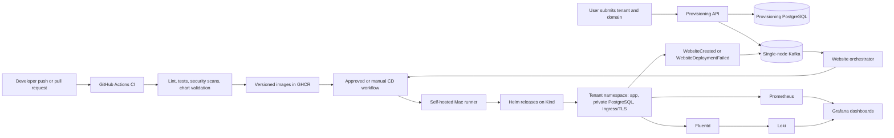

# Yotta website platform

A small Python-based platform for running isolated customer websites. Each tenant gets a Kubernetes namespace, its own website API, and a private PostgreSQL database. Helm manages every Kubernetes deployment.

## Assignment coverage

The assignment is implemented across the service code, Helm charts, GitHub Actions workflows, and local demo scripts. In the latest end-to-end setup, all three sample tenants deployed and passed HTTPS readiness checks. GitHub CI is green on the current commit; automated GitHub CD still needs the registered runner's missing label.

| Assignment requirement | Status | Implementation and evidence |
| --- | --- | --- |
| Deploy `user1`, `user2`, and `user3` in separate namespaces | Verified in the latest local end-to-end setup | `scripts/e2e-setup.sh` and `helm/website`; all three namespaces and releases are deployed. See the [fresh validation report](docs/assignment-validation-2026-11-16.md) |
| Automatically configure Ingress TLS for each website | Verified for all three tenants and provisioning API | `helm/website/templates/ingress.yaml`, `helm/platform/templates/cluster-issuer.yaml`; all four local certificates are Ready (self-signed) |
| Readiness/liveness probes, resource requests/limits, and network policies | Configured; all three apps and databases are healthy | `helm/website/templates/deployment.yaml`, `helm/website/templates/networkpolicy.yaml`, `helm/website/values.yaml`; cross-tenant isolation was checked in the earlier demo |
| Add custom tenant domains without recreating the cluster | Verified with the three matching tenant hosts | Provisioning event and tenant Helm releases supply each domain; current HTTPS readiness checks passed for all three |
| Build and publish images; deploy; roll back on failure; publish Kafka events | Current CI and local end-to-end deploy passed; GitHub CD not verified | CI/CD workflows, `scripts/deploy-tenant.sh`, `helm/website/templates/event-publisher-test.yaml`; GitHub runner label still needs `yotta-local-k8s` |
| Support multiple branches/users | Met in workflow configuration | Branch filters in `.github/workflows/`; tenant and domain are workflow inputs |
| Use Node.js or Python Flask for the sample website | Not met as written | `services/website-app/src/server.py` currently uses Python's standard-library `http.server`; the provisioning API uses FastAPI |
| HPA on CPU and memory, per-tenant quotas, and PDB | Configured and present for all tenants | `helm/website/templates/hpa.yaml`, `resourcequota.yaml`, and `pdb.yaml`; memory-based scaling is configured but has not been separately stress-tested |
| Simulate load and demonstrate autoscaling | HPA is live; load demo is historical | `scripts/load_test.py`; earlier validation recorded 3,594 successful requests and scale-out from 2 to 8 replicas |
| Prometheus/Grafana dashboards for cluster and website metrics | Stack and dashboard are live | `helm/monitoring/values.yaml`, `helm/platform/files/website-dashboard.json`; Prometheus, Grafana, Fluentd, Loki, and dashboard ConfigMap are present |
| Single-node Kafka; produce and consume deployment events | Verified for the three setup deployments | `docker-compose.yml`, `helm/platform/templates/kafka.yaml`, `services/website-orchestrator/`; notifications logged for all three tenants and consumer lag is zero |
| Required repo files, README, and proof of work | Repo/README met; fresh local setup proof saved | Dockerfiles, Helm charts, workflows, dated snapshots in `output/`, [local setup log](docs/logs/kind-local-installation.logs), and this report; no GitHub CD artifact was generated by the local setup |

### What remains before claiming a fully verified live pipeline

- The online self-hosted runner currently has `self-hosted`, `macOS`, and `ARM64` labels, but CD requires `yotta-local-k8s`. Add the required label, run the website deployment workflow, and retain its uploaded artifact.
- The assignment's CPU autoscaling demo was exercised. The memory HPA target is configured, but memory-driven scale-out was not separately demonstrated.
- Cross-tenant isolation and load scaling were demonstrated in the earlier run, but were not repeated during this setup.
- The sample website uses Python's standard-library HTTP server rather than Node.js or Flask, as requested in the assignment examples.

The three-tenant local setup now passes, and CI is green on the current commit. The remaining gaps are the required sample-app framework, an appropriately labeled runner for GitHub CD, and a fresh memory-based scaling demonstration. See the [fresh validation report](docs/assignment-validation-2026-11-16.md) for exact checks and results.

## Architecture and workflow



CI runs validation on changes and publishes immutable/versioned service images after successful validation. CD is a separate workflow: platform and provisioning deployments are manual, while tenant deployment is dispatched after a provisioning event is accepted. The local CD workflows require the configured Mac runner. Helm owns Kubernetes resources; a failed tenant rollout or health check triggers rollback, then the workflow publishes a failure event.

Example tenant install (the deployment script also supplies the tenant-specific domain, app image, and orchestrator image):

```sh
helm upgrade --install user4 helm/website --namespace user4 --create-namespace \\
  --set tenant.name=user4 \\
  --set ingress.host=user4.myyotta.com \\
  --set-string image.repository=ghcr.io/your-github-owner/website-app \\
  --set-string image.tag=1.0.0-20261115081354-43693315269 \\
  --wait --timeout 10m
```

## Request flow

1. A user submits a tenant name and domain to the Provisioning API.
2. The FastAPI service validates the request, saves it in PostgreSQL, and publishes `WebsiteProvisioningRequested` to Kafka.
3. The deployment orchestrator consumes that event and dispatches the website-app deployment pipeline.
4. GitHub Actions installs or upgrades the website with Helm on the Mac's Kind cluster.
5. The workflow checks the HTTPS health endpoint. A successful Helm test publishes `WebsiteCreated`. If deployment fails, Helm rolls back and the workflow publishes `WebsiteDeploymentFailed`.
6. The lifecycle consumer logs a human-readable notification and can forward it to a configured webhook.

## First-time setup

Install Docker Desktop, Kind, kubectl, Helm 3.17+, Python 3.12+, and a self-hosted GitHub Actions runner on the Mac. Create a fine-grained GitHub token for the target repository with **Actions: Read and write**. The orchestrator uses it only to dispatch the deployment workflow.

Set the repository and token before installing the local platform:

```sh
export ORCHESTRATOR_REPOSITORY=owner/repository
export ORCHESTRATOR_GITHUB_TOKEN=your-fine-grained-token
./scripts/setup-kind.sh
```

The token is stored in the platform's Kubernetes Secret so the in-cluster orchestrator can dispatch workflows. For a production cluster, use an external secret manager instead of Helm values.

After the cluster is ready, run **Actions → Website Provisioning Deployment → Run workflow** from `master` and provide the published `image_tag`. This separately installs or upgrades the provisioning API and its database. Changes to the service still run its CI checks and publish an image, but do not deploy it automatically.

## Submit a website request

Forward the provisioning API to your Mac:

```sh
kubectl port-forward -n platform svc/website-provisioning 3001:80
```

Submit a tenant and domain to the FastAPI endpoint. The `tenant` becomes the namespace and Helm release name; the domain is added to Ingress dynamically.

```sh
curl -sS -X POST http://127.0.0.1:3001/api/v1/websites \
  -H 'Content-Type: application/json' \
  -d '{"tenant":"user4","domain":"user4.localtest.me"}'
```

The API returns `202 Accepted` with an event ID. It publishes `WebsiteProvisioningRequested`. After the deployment, the platform publishes either `WebsiteCreated` or `WebsiteDeploymentFailed`. Follow the event and workflow logs with:

```sh
kubectl logs -n platform deployment/website-orchestrator -f
kubectl logs -n platform deployment/website-provisioning -f
```

For this local demo, `*.localtest.me` resolves to loopback and the self-signed certificate requires `curl -k` or a browser exception.

## What the assignment demo includes

- Sample tenants `user1`, `user2`, and `user3`, plus dynamic tenant names and domains.
- Separate PostgreSQL databases, Kubernetes namespaces, Secrets, and network policies.
- TLS Ingress, liveness/readiness probes, CPU and memory requests/limits, quotas, and PodDisruptionBudgets.
- CPU/memory HPA, a Python load generator, Prometheus, Grafana dashboards, Fluentd, and Loki.
- Kafka request and outcome events, workflow dispatch, Helm rollback, Docker image scans, and build evidence uploaded as a GitHub Actions artifact.
- A timestamped image version such as `1.0.0-20261115081354-43693315269`; edit `VERSION` to change the major, minor, or patch number.

Run the load generator while watching the HPA:

```sh
kubectl get hpa -n user1 -w
python3 scripts/load_test.py --tenant user1 --seconds 180 --workers 40
```

## CI/CD and local deployment

Service workflows validate and publish Python service images on `master` and feature branches. Each published image gets a unique UTC timestamp tag down to seconds plus the GitHub run ID, while commit tags remain available for tracing. Pull requests run the same validation without publishing. Website App CI builds and publishes the `website-app` image; a separate website-app deployment pipeline runs on the Mac only after a website request is accepted by Kafka. Provisioning deployment is manual and accepts a selected published image tag. Platform CI validates the charts and Fluentd image and publishes a versioned image; the separate manual Platform Deployment workflow installs cluster add-ons, the platform chart, and Prometheus/Grafana through Helm on the Mac.

CI checks Python style and unit tests, scans Python code and dependencies, checks for committed secrets, lints Dockerfiles, scans built images, and starts each API image against PostgreSQL to check its health endpoint. The Kafka workflow also sends an event through a real local broker. Helm charts are linted, rendered, checked against Kubernetes schemas, and scanned for deployment security settings.

To deploy the three sample tenants manually through Helm:

```sh
IMAGE=ghcr.io/<owner>/website-app:<image-tag> \\
ORCHESTRATOR_IMAGE=ghcr.io/<owner>/website-orchestrator:<image-tag> \\
PULL_IMAGE=true ./scripts/deploy-platform.sh
```

To check a deployment and capture local evidence:

```sh
./scripts/verify-deployment.sh user1 user1.localtest.me
```

Docker Compose is for local development and the Kafka integration test. It defaults the orchestrator to dry-run mode. To make Compose dispatch a real GitHub workflow, set `ORCHESTRATOR_DRY_RUN=false`, `ORCHESTRATOR_REPOSITORY`, and `ORCHESTRATOR_GITHUB_TOKEN`.

Deployment outcome notifications are written to the website-orchestrator logs by default, which Fluentd forwards to Loki. To also send them to a webhook, set `NOTIFICATION_WEBHOOK_URL` before running `scripts/setup-kind.sh`; the platform chart stores it in a Kubernetes Secret.

See [deployment instructions](docs/deployment.md), [architecture](docs/architecture.md), [local runner setup](docs/local-runner.md), and [rollback notes](docs/rollback.md).
