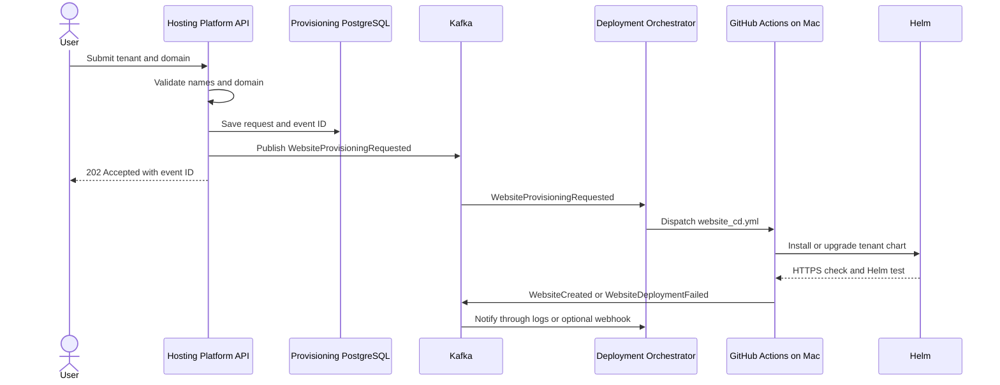

# Architecture

## Website request to deployment

## What runs in Kubernetes

Shared services are separate Helm releases, one per lifecycle: `kafka` (Kafka + kafka-exporter, namespace `platform`, `helm/kafka-helm`), `logging` (Loki + Fluentd, namespace `observability`, `helm/logging-helm`), `grafana-dashboards` next to Grafana (`helm/monitoring/grafana-dashboards`), and `cluster-issuer` next to cert-manager (`helm/cluster-addons/cluster-issuer`). The Python deployment orchestrator is its own release (`website-orchestrator`, `helm/website-orchestrator-helm`) next to Kafka. The `hosting-platform` API is a separate release too; all services keep their data in the shared platform database.

Each website has a separate namespace and Helm release. Its release contains the Flask website (served by gunicorn), Ingress, ServiceMonitor, HPA, PDB, quota, LimitRange, and NetworkPolicies. Websites keep no data of their own: they check the shared platform database (below) for readiness, and their NetworkPolicy allows only DNS and that database as egress.

Helm owns Kubernetes resources. `kubectl` is used for read-only checks, logs, port forwarding, and readiness inspection. Tenant deployments, platform updates, and the Day 0 API install all use Helm.

## Request and event handling

All platform services share one database, `myyotta_platform` (PostgreSQL 16, release `myyotta-postgresql` in `platform-data`; schema in `services/database/init`; design, ER diagram and table structure in [services/database/README.md](../services/database/README.md#database-design)). Each service reads the password from a copy of the Secret in its own namespace (`scripts/copy-database-secret.sh`), and the database's NetworkPolicy only admits pods labelled `myyotta.io/database-client: "true"`.

The FastAPI `hosting-platform` service registers and lists users (`POST /api/v1/users/register`, salted scrypt hashes; `GET /api/v1/users`) and exposes `POST/GET/DELETE /api/v1/websites` without login; a website names its owner by e-mail. A request stores the website, its platform domain, default configuration and a request event in one transaction, then publishes `WebsiteProvisioningRequested` to Kafka and marks the event published. Repeating an accepted request returns the same event ID; reusing a tenant or domain for another request returns a conflict. `DELETE` marks the website `DELETING` and publishes `WebsiteDeletionRequested`; the orchestrator starts the *Website Teardown* workflow (approval, `helm uninstall`, namespace delete), which publishes `WebsiteDeleted`, and the orchestrator then removes the record. The orchestrator also records every deployment outcome (`deployments`, `deployment_events`) and keeps `websites.status` current (`PENDING → PROVISIONING → ACTIVE / FAILED → DELETING`).

The orchestrator uses a stable Kafka consumer group and commits an offset only after GitHub accepts the workflow dispatch. It dispatches the `website_cd.yml` workflow with the tenant, domain, image, and correlation ID. If dispatch fails, it leaves the event uncommitted and retries. The website API CI builds and publishes images independently; hosting-platform API deployment is a separate manual pipeline.

After Helm installs the tenant, the HTTPS health check must pass. The chart's Helm test then publishes `WebsiteCreated`. If installation, health checks, or the Helm test fail, the deployment script rolls back and the Actions workflow publishes `WebsiteDeploymentFailed`. The website orchestrator sends a short notification to logs (also collected by Fluentd and Loki), or to an optional configured webhook. Only `WebsiteProvisioningRequested` starts a deployment.

Published images use a timestamped version such as `1.0.0-20261116010802`: the base version comes from `VERSION` and the UTC build time is added to the second, so every build gets its own sortable tag.

## Scaling and observability

Every website deployment requests CPU and memory. Its HPA scales on both metrics, within the configured tenant quota. The Python load generator calls the CPU workload endpoint so the HPA can be observed under load. A PodDisruptionBudget (`maxUnavailable: 1`) limits voluntary evictions to one pod at a time without blocking node drains at the lab default of one replica.

Prometheus Operator scrapes each tenant's ServiceMonitor. Grafana includes website request, replica, and log panels. Fluentd reads container logs, adds Kubernetes metadata, and sends them to Loki.

## Extra: AIOps pod doctor

A CronJob in the `aiops` namespace runs every minute. It finds one newly failing pod anywhere in the cluster,
collects its status, events and logs (secrets masked), asks Grok (xAI) for the root cause and a fix, and
e-mails the report, clearly marked as AI-generated. Each failure is reported once (state in a ConfigMap). It
only reads the cluster and never changes it. The Grok key and the e-mail login are Kubernetes Secrets, mounted
as files. Details: [aiops-pod-doctor/README.md](../aiops-pod-doctor/README.md).
