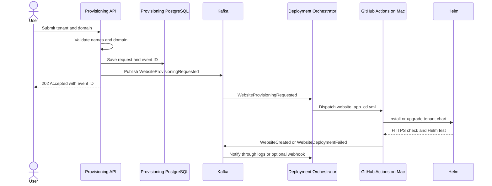

# Architecture

## Website request to deployment

## What runs in Kubernetes

The Helm `platform` release installs Kafka, the Python deployment orchestrator, Loki, Fluentd, the local ClusterIssuer, and the Grafana dashboard. The `website-provisioning` API and its private PostgreSQL database are a separate Helm release installed by the Day 0 GitHub Actions workflow.

Each website has a separate namespace and Helm release. Its release contains the website API, private PostgreSQL StatefulSet with a persistent volume claim, generated database Secret, Ingress, ServiceMonitor, HPA, PDB, quota, LimitRange, and NetworkPolicies. Tenants do not share databases. The Provisioning API also has its own PostgreSQL database and persistent volume.

Helm owns Kubernetes resources. `kubectl` is used for read-only checks, logs, port forwarding, and readiness inspection. Tenant deployments, platform updates, and the Day 0 API install all use Helm.

## Request and event handling

The FastAPI `website-provisioning` service exposes `POST /api/v1/websites`. It accepts a DNS-safe tenant name and domain, stores the metadata and a stable event ID in its own PostgreSQL database, then publishes `WebsiteProvisioningRequested` to Kafka. Repeating an accepted request for the same tenant and domain returns the same event ID; reusing either value for a different request returns a conflict.

The orchestrator uses a stable Kafka consumer group and commits an offset only after GitHub accepts the workflow dispatch. It dispatches the `website_app_cd.yml` workflow with the tenant, domain, image, and correlation ID. If dispatch fails, it leaves the event uncommitted and retries. The website API CI builds and publishes images independently; provisioning API deployment is a separate manual pipeline.

After Helm installs the tenant, the HTTPS health check must pass. The chart's Helm test then publishes `WebsiteCreated`. If installation, health checks, or the Helm test fail, the deployment script rolls back and the Actions workflow publishes `WebsiteDeploymentFailed`. The website orchestrator sends a short notification to logs (also collected by Fluentd and Loki), or to an optional configured webhook. Only `WebsiteProvisioningRequested` starts a deployment.

Published images use a unique timestamped version such as `1.0.0-20261115081354-43693315269`; the base version comes from `VERSION` and the workflow run ID prevents same-second collisions.

## Scaling and observability

Every website deployment requests CPU and memory. Its HPA scales on both metrics, within the configured tenant quota. The Python load generator calls the CPU workload endpoint so the HPA can be observed under load. A PodDisruptionBudget protects availability during voluntary updates.

Prometheus Operator scrapes each tenant's ServiceMonitor. Grafana includes website request, replica, and log panels. Fluentd reads container logs, adds Kubernetes metadata, and sends them to Loki.
