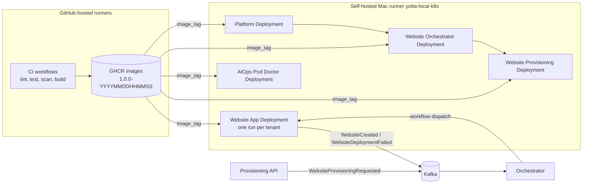

# GitHub Actions runbook

End-to-end reference for every pipeline in this repository: what triggers it, what it does step by step,
what it needs, how to run it, and how to fix the usual failures.

- [1. How the pipelines fit together](#1-how-the-pipelines-fit-together)
- [2. One-time setup](#2-one-time-setup)
- [3. Shared building blocks](#3-shared-building-blocks)
- [4. CI pipelines](#4-ci-pipelines)
- [5. CD pipelines](#5-cd-pipelines)
- [6. End-to-end run (fresh cluster to working website)](#6-end-to-end-run-fresh-cluster-to-working-website)
- [7. Day-2 operations](#7-day-2-operations)
- [8. Troubleshooting](#8-troubleshooting)

---

## 1. How the pipelines fit together



| Component | CI workflow (builds the image) | CD workflow (deploys it) | Approval environment |
|---|---|---|---|
| Platform: add-ons, Kafka, Loki, Fluentd, monitoring | `platform_ci.yml` (Fluentd image) | `platform_cd.yml` | `platform-deployment` |
| Website orchestrator (Kafka consumer) | `website_orchestrator_ci.yml` | `website_orchestrator_cd.yml` | `website-orchestrator-deployment` |
| Provisioning API (FastAPI) | `website_provisioning_ci.yml` | `website_provisioning_cd.yml` | `website-provisioning-deployment` |
| Tenant website (Flask) | `website_app_ci.yml` | `website_app_cd.yml` | `website-app-deployment` |
| AIOps pod doctor | `aiops_pod_doctor_ci.yml` | `aiops_pod_doctor_cd.yml` | `aiops-deployment` |
| *(shared)* | `service_ci.yml` (reusable) | | |

**Rules that apply to all of them**

- **CI** runs on GitHub-hosted `ubuntu-latest`. **CD** runs on the self-hosted Mac runner (labels `self-hosted`, `macOS`, `yotta-local-k8s`), because the Kind cluster lives on that Mac.
- CI runs on push and pull requests to `master`, `feature` and `feature/**` when that component's files change (Website Orchestrator CI: any branch, any change). Pull requests validate only; pushes also **publish** the image.
- CD never runs on push: it is started manually (`workflow_dispatch`) or, for websites, by the orchestrator.
- Every CD deploy job waits for **manual approval** in its own GitHub environment.
- All CD jobs share the concurrency group `local-platform-release`, so two deployments never touch the cluster at the same time; a second run waits.
- Non-secret settings (cluster name, namespaces, versions, timeouts) live in [`.github/pipeline-config.env`](../.github/pipeline-config.env) and are loaded by every job.

---

## 2. One-time setup

| # | What | How |
|---|---|---|
| 1 | Tools on the Mac | Docker Desktop, Kind, kubectl, Helm 4.x, Python 3.9+ (`python3`), GitHub CLI `gh` |
| 2 | Kind cluster | `./scripts/setup-kind.sh` (or `./scripts/e2e-setup.sh` for everything) |
| 3 | Self-hosted runner | Settings → Actions → Runners → *New self-hosted runner* (macOS), label **`yotta-local-k8s`**; keep `./run.sh` running. Details: [local-runner.md](local-runner.md) |
| 4 | Repository secret `ORCHESTRATOR_GITHUB_TOKEN` | Fine-grained PAT for this repo with **Actions: Read and write**: `gh secret set ORCHESTRATOR_GITHUB_TOKEN` |
| 5 | Approval environments | `./scripts/setup-deployment-approvals.sh` (creates all five, you as reviewer, deploys only from `master`, `feature`, `feature/*`) |
| 6 | Grok key (AIOps only) | `gh secret set GROK_API_KEY --env aiops-deployment`; optional `gh variable set GROK_MODEL --env aiops-deployment --body grok-4` |
| 7 | Local names | `127.0.0.1 provisioning.myyotta.com user1.myyotta.com user2.myyotta.com user3.myyotta.com` in `/etc/hosts` |

Check the runner is online: `gh api repos/{owner}/{repo}/actions/runners --jq '.runners[] | [.name,.status,(.labels|map(.name)|join(","))] | @tsv'`

---

## 3. Shared building blocks

| File | Used by | Purpose |
|---|---|---|
| `.github/pipeline-config.env` | all jobs | shared settings → `$GITHUB_ENV` and step outputs |
| `.github/scripts/load-pipeline-config.sh` | all jobs | loads the file above, rejects malformed entries |
| `scripts/build-version.sh` | all CI publish jobs | prints the image tag `<VERSION>-<UTC yyyymmddHHMMSS>` |
| `.github/scripts/validate-image-tag.sh` | all CD jobs | accepts only `MAJOR.MINOR.PATCH-YYYYMMDDHHMMSS`, explains what is wrong otherwise |
| `scripts/load-image-into-kind.sh` | CD jobs | pulls only the node's platform (arm64/amd64) of a multi-platform image and loads it into Kind |
| `scripts/deploy-tenant.sh` | `website_app_cd.yml`, local setup | Helm install/upgrade of one tenant with HTTPS check, Helm test and automatic rollback |
| `.github/scripts/resolve-website-images.sh` | `website_app_cd.yml` | picks the website image (requested or newest) and the orchestrator image (requested or running) |
| `scripts/setup-deployment-approvals.sh` | you, once | creates the approval environments |

**Image tags.** Each publish pushes several tags; **deploy the version tag** shown on the run summary under
*Deployment image tag*:

| Tag | Example | Use |
|---|---|---|
| version | `1.0.0-20261116041523` | **the one to deploy** (immutable, sortable) |
| commit | `sha-<full sha>`, `<short sha>` | trace an image back to its commit |
| branch | `master`, `feature-x` | latest build of a branch |
| `latest` | | latest build of `master` |

Find a tag from the terminal: `gh run view <ci-run-id> --log | grep -oE '[0-9]+\.[0-9]+\.[0-9]+-[0-9]{14}' | sort -u`

---

## 4. CI pipelines

### 4.1 Service CI (`service_ci.yml`, reusable)

Called by Website App CI, Website Provisioning CI and AIOps Pod Doctor CI with `service`, `image` and optional `path`
(default `services/<service>`).

**Job `validate`** (pull requests and pushes)

| Step | Tool | Fails when |
|---|---|---|
| Install dependencies | pip | requirements cannot be installed |
| Python lint | ruff | style or bug patterns |
| Unit tests | pytest | any test fails |
| Static security scan | Bandit | risky code (e.g. shell injection) |
| Dependency audit | pip-audit `--strict` | a dependency has a known vulnerability |
| Secret scan | Gitleaks | a credential is committed |
| Dockerfile lint | hadolint | Dockerfile best-practice issue |
| Owner-only build context | `chmod -R go-rwx` | *(guard: proves the image does not depend on host file permissions)* |
| Build image | Buildx | image does not build |
| Image scan | Trivy | HIGH/CRITICAL fixable vulnerability (exceptions in `.trivyignore`) |
| Runtime check | docker | container with PostgreSQL + Kafka does not answer `/health/live` within 20 s |

**Job `publish`** (pushes and manual runs only): computes the version, logs in to GHCR, builds
`linux/amd64,linux/arm64` with provenance and SBOM, pushes all tags, writes the version tag to the run summary.

### 4.2 Website App CI / Website Provisioning CI / AIOps Pod Doctor CI

1. **`chart-validation`**: `helm lint`, `helm template`, kubeconform schema validation, Trivy misconfiguration scan
   of the rendered chart (AIOps also runs ShellCheck on its scripts).
2. **Service CI** (above) for the service image.

| Workflow | Triggers on changes to |
|---|---|
| Website App CI | `services/website-app/**`, `helm/website/**`, shared CI files |
| Website Provisioning CI | `services/website-provisioning/**`, `helm/website-provisioning/**`, shared CI files |
| AIOps Pod Doctor CI | `aiops-pod-doctor/**`, shared CI files |

### 4.3 Website Orchestrator CI (`website_orchestrator_ci.yml`)

Self-contained; runs on every push and pull request, on any branch. `validate`: ruff, pytest, Bandit, pip-audit, Gitleaks,
hadolint, image build, Trivy, and a **Kafka integration check** (real broker: publish a
`WebsiteProvisioningRequested` event, the orchestrator container in dry-run mode must log that it consumed it). `publish`: multi-platform image to GHCR with the version tag.

### 4.4 Platform CI (`platform_ci.yml`)

`validate`: renders and schema-checks the platform, monitoring and pinned cluster add-on charts, scans them with
Trivy, lints/builds/tests/scans the Fluentd image. `publish`: Fluentd image `fluentd-loki:<version>`.

---

## 5. CD pipelines

Common to all: **(1)** a GitHub-hosted job lints/renders the chart (most CDs), **(2)** the deploy job on the Mac
**waits for approval**, then validates the tag, checks the cluster, logs in to GHCR, loads the image into Kind and
runs `helm upgrade --install … --wait`.

### 5.1 Platform Deployment (`platform_cd.yml`)

| Input | Required | Value |
|---|---|---|
| `image_tag` | yes | Fluentd tag from Platform CI |

Needs: repository secret `ORCHESTRATOR_GITHUB_TOKEN`. Steps: validate tag → Kind ready → load Fluentd image →
cluster add-ons (Calico, ingress-nginx, cert-manager, metrics-server) → `platform` release (Kafka, orchestrator,
Loki, Fluentd, issuer, dashboard) → `prometheus` release (Prometheus + Grafana).

```sh
gh workflow run platform_cd.yml --ref master -f image_tag=<tag>
```

### 5.2 Website Orchestrator Deployment (`website_orchestrator_cd.yml`)

| Input | Required | Value |
|---|---|---|
| `image_tag` | yes | tag from Website Orchestrator CI |

Needs: `ORCHESTRATOR_GITHUB_TOKEN` (stored in the cluster so the orchestrator can start Website App Deployment).
Upgrades only the orchestrator inside the `platform` release.

```sh
gh workflow run website_orchestrator_cd.yml --ref master -f image_tag=<tag>
```

### 5.3 Website Provisioning Deployment (`website_provisioning_cd.yml`)

| Input | Required | Value |
|---|---|---|
| `image_tag` | yes | tag from Website Provisioning CI |

Installs/upgrades the `website-provisioning` release (API + its PostgreSQL) in `platform`; requires the platform
release to exist.

```sh
gh workflow run website_provisioning_cd.yml --ref master -f image_tag=<tag>
```

### 5.4 Website App Deployment (`website_app_cd.yml`)

Started **automatically by the orchestrator** for every accepted website request, or manually.

| Input | Required | Value |
|---|---|---|
| `tenant` | yes | DNS-safe name, becomes namespace and Helm release |
| `domain` | yes | host for the tenant's Ingress |
| `image_tag` | no | website-app tag; empty = newest published |
| `orchestrator_image_tag` | no | image for the event-publishing Helm test; empty = the one running |
| `correlation_id` | no | provisioning request event ID (set by the orchestrator) |
| `simulate_failure` | no | `true` = rollback demo (broken readiness probe) |

Steps: cluster + platform check → choose images → Python venv for the event publisher → Kafka port-forward →
**`deploy-tenant.sh`** (Helm `--rollback-on-failure --wait`, HTTPS readiness, `helm test` which publishes
`WebsiteCreated`) → on failure: publish **`WebsiteDeploymentFailed`**, roll back, fail the run → upload artifact
`website-deployment-evidence-<run id>` (resources, Helm history, events, orchestrator log, pods; 14 days).

```sh
gh workflow run website_app_cd.yml --ref master -f tenant=user1 -f domain=user1.myyotta.com
gh workflow run website_app_cd.yml --ref master -f tenant=user1 -f domain=user1.myyotta.com -f simulate_failure=true   # rollback demo
```

### 5.5 AIOps Pod Doctor Deployment (`aiops_pod_doctor_cd.yml`)

| Input | Required | Value |
|---|---|---|
| `image_tag` | yes | tag from AIOps Pod Doctor CI |
| `demo_failure` | no | `crash` (default), `image-pull`, `missing-secret`, `none` |

Needs: environment secret `GROK_API_KEY` on `aiops-deployment` (optional variable `GROK_MODEL`). Steps: tag and
cluster checks → load image → store the key as Secret `aiops-grok-api-key` → Helm release in `aiops` → negative
test: break a demo pod in `aiops-demo`, wait up to 3 min for the doctor's Grok report, add it to the run summary,
delete the demo pod.

```sh
gh workflow run aiops_pod_doctor_cd.yml --ref master -f image_tag=<tag> -f demo_failure=crash
```

### Approving a deployment

Run page → **Review deployments** → tick the environment → **Approve and deploy** (or **Reject**). Nothing runs on
the Mac before that. From the terminal: `gh run view <run-id> --web`.

---

## 6. End-to-end run (fresh cluster to working website)

| # | Do | Check |
|---|---|---|
| 1 | `./scripts/setup-kind.sh` | `kind get clusters` lists `yotta-platform` |
| 2 | Push (or *Run workflow*) every CI; all green | `gh run list --limit 10` |
| 3 | `platform_cd.yml` with the Platform CI tag, approve | `helm list -A` shows `platform`, `prometheus` |
| 4 | `website_orchestrator_cd.yml` with its tag, approve | `kubectl get deploy website-orchestrator -n platform` ready |
| 5 | `website_provisioning_cd.yml` with its tag, approve | `curl -k https://provisioning.myyotta.com:8443/health/ready` |
| 6 | Request a website (below) | a *Website App Deployment* run appears; approve it |
| 7 | Open the website | `curl -k https://user4.myyotta.com:8443/api/v1` |
| 8 | Optional: `aiops_pod_doctor_cd.yml` | Grok report in the run summary |

```sh
curl -k -i -X POST https://provisioning.myyotta.com:8443/api/v1/websites \
  -H 'Content-Type: application/json' -d '{"tenant":"user4","domain":"user4.myyotta.com"}'
kubectl logs -n platform deploy/website-orchestrator -f        # "dispatched workflow" ...
gh run list --workflow website_app_cd.yml --limit 3
```

---

## 7. Day-2 operations

| Task | How |
|---|---|
| Release a new website version | push to `services/website-app/**` → CI publishes → `website_app_cd.yml` per tenant with the new `image_tag` |
| Roll back a tenant | `website_app_cd.yml` with the previous `image_tag`, or `helm rollback <tenant> <rev> -n <tenant>` ([rollback.md](rollback.md)) |
| Change the version number | edit `VERSION` (e.g. `1.1.0`); next builds are `1.1.0-<timestamp>` |
| Rotate the orchestrator token | `gh secret set ORCHESTRATOR_GITHUB_TOKEN`, then re-run `website_orchestrator_cd.yml` |
| Rotate the Grok key | `gh secret set GROK_API_KEY --env aiops-deployment`, then re-run `aiops_pod_doctor_cd.yml` |
| Add a reviewer | `./scripts/setup-deployment-approvals.sh <login> [<login>...]` |
| See what is deployed | `helm list -A`; `kubectl get deploy -A -o wide` |
| Collect proof of work | `./scripts/collect-proof.sh` ([proof-of-work.md](proof-of-work.md)) |

---

## 8. Troubleshooting

| Symptom | Cause | Fix |
|---|---|---|
| CD job stays *Queued* / "Waiting for a runner" | Mac runner offline or label missing | start `./run.sh` on the Mac; check it has label `yotta-local-k8s` |
| Run waits at *Review deployments* | approval required (by design) | approve it |
| `Invalid image tag` | not a `1.0.0-YYYYMMDDHHMMSS` tag (empty, spaces, full image name, old format) | copy the tag from the CI summary |
| `manifest unknown` / `not found` pulling the image | tag of a different image, or CI did not publish (PR run) | use the tag from that component's CI push run |
| `content digest ... not found` loading into Kind | multi-platform image | already handled by `load-image-into-kind.sh`; make sure the run uses the current workflow |
| `Add the repository secret ORCHESTRATOR_GITHUB_TOKEN` | secret missing | `gh secret set ORCHESTRATOR_GITHUB_TOKEN` (fine-grained, Actions read/write) |
| `Missing GROK_API_KEY` | secret missing on the environment | `gh secret set GROK_API_KEY --env aiops-deployment` |
| `HTTP 404` from `gh secret set --env` | environment does not exist | `./scripts/setup-deployment-approvals.sh` |
| Website request accepted but no deployment run | orchestrator token missing/expired, or orchestrator down | `kubectl logs -n platform deploy/website-orchestrator` |
| Website App Deployment red with rollback | rollout, HTTPS check or Helm test failed | read the run log and the evidence artifact; tenant stays on the previous revision |
| `PermissionError` reading files in a pod | image built from owner-only files | fixed in the Dockerfiles (`chmod -R a+rX /app`); rebuild |
| `mkdir: /Users/runner: Permission denied` | `actions/setup-python` on a self-hosted Mac | CD uses the Mac's `python3` in a venv instead; do not add setup-python to CD jobs |
| ShellCheck / ruff / hadolint failure in CI | lint finding | fix the reported line; CI fails on info-level findings too |
