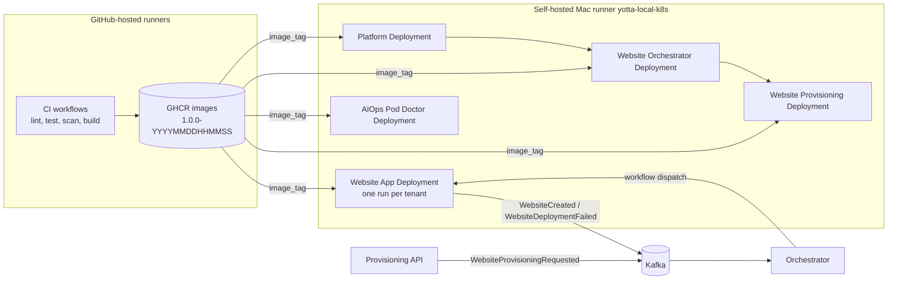

# GitHub Actions runbook

End-to-end reference for every pipeline in this repository: what triggers it, what it does step by step,
what it needs, how to run it, and how to fix the usual failures.

- [1. Framework structure](#1-framework-structure)
- [2. How the pipelines fit together](#2-how-the-pipelines-fit-together)
- [3. One-time setup](#3-one-time-setup)
- [4. Shared building blocks](#4-shared-building-blocks)
- [5. CI pipelines](#5-ci-pipelines)
- [6. CD pipelines](#6-cd-pipelines)
- [7. End-to-end run (fresh cluster to working website)](#7-end-to-end-run-fresh-cluster-to-working-website)
- [8. Day-2 operations](#8-day-2-operations)
- [9. Troubleshooting](#9-troubleshooting)

---

## 1. Framework structure

```text
yotta-multitenant-platform/
├── README.md                     Project overview, deliverables map, quick start
├── VERSION                       Base image version (1.0.0); CI appends the UTC build time
├── docker-compose.yml            Local dev: PostgreSQL, Kafka, provisioning API, orchestrator (dry-run)
├── .trivyignore                  Documented image-scan exceptions (one false positive)
├── .gitignore                    Ignored local files (venv, output/, runner files, .DS_Store)
│
├── .github/
│   ├── pipeline-config.env       Shared non-secret pipeline settings (cluster, namespaces, versions, timeouts)
│   ├── actionlint.yaml           Tells actionlint about the self-hosted runner labels
│   ├── scripts/
│   │   ├── load-pipeline-config.sh     Loads pipeline-config.env into every job
│   │   ├── validate-image-tag.sh       CD guard: only MAJOR.MINOR.PATCH-YYYYMMDDHHMMSS tags
│   │   ├── resolve-website-images.sh   Website CD: requested or newest app image, running orchestrator image
│   │   ├── helm-releases.sh            The Helm options of each CD release, used by review-changes and deploy
│   │   ├── validate-chart.sh           CD validate-chart: helm lint + template + kubeconform
│   │   ├── newest-image-tag.sh         Newest published version tag of a GHCR image
│   │   └── update-orchestrator-token.sh Refreshes the orchestrator's GitHub token Secret in the cluster
│   └── workflows/
│       ├── reusable-service-ci.yml  Reusable CI: lint, tests, security scans, image build/scan/run, publish
│       ├── website_app_ci.yml / _cd.yml            Tenant website: build / deploy one tenant (+ rollback demo)
│       ├── website_provisioning_ci.yml / _cd.yml   Provisioning API: build / deploy
│       ├── website_orchestrator_ci.yml / _cd.yml   Kafka orchestrator: build + Kafka test / deploy
│       ├── platform_ci.yml / platform_cd.yml       Charts + Fluentd image / add-ons, platform, monitoring
│       └── aiops_pod_doctor_ci.yml / _cd.yml       AIOps doctor: build / deploy the CronJob + one report run
│
├── services/                     Application code (one folder = one container image)
│   ├── website-app/              Tenant website (Flask + gunicorn)
│   │   ├── src/app.py            Routes: /health/live, /health/ready, /api/v1, /api/v1/workload, /metrics
│   │   ├── src/server.py         Tenant database check + WSGI entry point (src.server:app)
│   │   ├── gunicorn.conf.py      Web server settings; waits for the database before serving
│   │   ├── test/                 Unit tests (Flask test client)
│   │   ├── Dockerfile            Non-root image with health check
│   │   └── requirements.txt      flask, gunicorn, psycopg
│   ├── website-provisioning/     Provisioning API (FastAPI)
│   │   ├── src/app.py            POST /api/v1/websites: validates tenant + domain, idempotent requests
│   │   ├── src/server.py         PostgreSQL storage, Kafka producer, uvicorn startup
│   │   └── test/, Dockerfile, requirements.txt
│   └── website-orchestrator/     Kafka consumer
│       ├── src/consumer.py       Consumes website-events; dispatches Website App Deployment; notifications
│       ├── publish_event.py      Publishes WebsiteCreated / WebsiteDeploymentFailed (Helm test, CD)
│       └── test/, Dockerfile, requirements.txt
│
├── helm/                         Kubernetes resources (everything is deployed with Helm)
│   ├── website-app/              One release per tenant (namespace = tenant)
│   │   └── templates/            deployment, service, ingress (TLS), postgres (StatefulSet + PVC),
│   │                             database-secret, hpa, pdb, resourcequota, limitrange, networkpolicy,
│   │                             servicemonitor, event-publisher-test (Helm test sending WebsiteCreated)
│   ├── website-provisioning/     Provisioning API + its PostgreSQL + Ingress
│   ├── platform/                 Shared services
│   │   ├── templates/            kafka, kafka-exporter (Kafka metrics), website-orchestrator, loki, fluentd, cluster-issuer (TLS),
│   │   │                         dashboard (Grafana ConfigMap), notification-secret (optional webhook)
│   │   └── files/                fluent.conf (log shipping), website-dashboard.json (Grafana dashboard)
│   ├── monitoring/               kube-prometheus-stack values, pinned chart version, .trivyignore
│   └── cluster-addons/           Calico CRDs (copied from the official chart, pinned)
│
├── images/
│   └── fluentd-loki/Dockerfile   Fluentd image that ships pod logs to Loki (built by Platform CI)
│
├── scripts/                      Automation used locally and by the pipelines
│   ├── setup-local-e2e.sh        One command: fresh Kind cluster + everything + user1-3
│   ├── setup-kind.sh             Create/update the cluster, add-ons, monitoring, platform
│   ├── deploy-cluster-addons.sh  Calico, ingress-nginx, cert-manager, metrics-server (versions in cluster-addons.env)
│   ├── deploy-sample-tenants.sh  Deploy the website chart for the sample tenants user1-user3
│   ├── deploy-tenant.sh          Deploy one tenant: Helm, HTTPS check, Helm test, automatic rollback
│   ├── load-image-into-kind.sh   Load only the node's platform of a multi-platform image into Kind
│   ├── build-version.sh          Image tag 1.0.0-YYYYMMDDHHMMSS
│   ├── helm-retry.sh             Retry wrapper for transient Helm/network errors
│   ├── check-docker.sh           Setup: Docker engine reachable (starts Colima, sizes it, fixes context, inotify)
│   ├── check-routes.sh           Every Ingress host answers 200, no duplicate hosts, no pod on an old image
│   ├── kafka-events.sh           Website status per tenant from Kafka events (--watch: live)
│   ├── generate-dashboard.py     Writes the Grafana dashboard JSON (helm/platform/files/website-dashboard.json)
│   ├── helm-release.sh           HELM_MODE=apply: helm upgrade --install; HELM_MODE=diff: coloured diff for review
│   ├── load-test.py              CPU load generator for the HPA demo
│   ├── collect-proof.sh          Proof-of-work evidence for all five assignment items
│   └── setup-deployment-approvals.sh  Creates the GitHub approval environments
│
├── aiops-pod-doctor/             Extra: explains failing pods with Grok
│   ├── service/                  Python: detector, RCA, Grok client, e-mail, CronJob run + tests
│   ├── helm/                     Deployment, Service, read-only ServiceAccount/ClusterRole
│   └── scripts/                  run-report-job.sh (start one report run now)
│
├── kind/cluster.yaml             Kind cluster: nodes, HTTP 8081 / HTTPS 8443 on the Mac
├── database/init/                Local docker-compose database bootstrap
├── self-hosted/self-hosted.sh    Downloads (checksum-verified) and registers the Mac runner (label yotta-local-k8s)
│
└── docs/
    ├── github-actions-runbook.md  This document
    ├── deployment.md             Detailed deployment guide
    ├── architecture.md           Request flow and what runs where
    ├── rollback.md               Automatic, CD and manual rollback
    ├── proof-of-work.md          How to demonstrate each assignment item
    ├── local-runner.md           Self-hosted runner setup
    ├── proof/                    Evidence folders written by collect-proof.sh (+ screenshots)
    └── logs/                     Log of a full local installation
```

---

## 2. How the pipelines fit together



| Component | CI workflow (builds the image) | CD workflow (deploys it) | Approval environment |
|---|---|---|---|
| Platform: add-ons, Kafka, Loki, Fluentd, monitoring | `platform_ci.yml` (Fluentd image) | `platform_cd.yml` | `platform-deployment` |
| Website orchestrator (Kafka consumer) | `website_orchestrator_ci.yml` | `website_orchestrator_cd.yml` | `website-orchestrator-deployment` |
| Provisioning API (FastAPI) | `website_provisioning_ci.yml` | `website_provisioning_cd.yml` | `website-provisioning-deployment` |
| Tenant website (Flask) | `website_app_ci.yml` | `website_app_cd.yml` | `website-app-deployment` |
| AIOps pod doctor | `aiops_pod_doctor_ci.yml` | `aiops_pod_doctor_cd.yml` | `aiops-deployment` |
| *(shared)* | `reusable-service-ci.yml` (reusable) | | |

**Rules that apply to all of them**

- **CI** runs on GitHub-hosted `ubuntu-latest`. **CD** runs on the self-hosted Mac runner (labels `self-hosted`, `macOS`, `yotta-local-k8s`), because the Kind cluster lives on that Mac.
- CI runs on push and pull requests to `master`, `feature` and `feature/**` when that component's files change (Website Orchestrator CI: any branch, any change). Pull requests validate only; pushes also **publish** the image.
- CD never runs on push: it is started manually (`workflow_dispatch`) or, for websites, by the orchestrator.
- Every CD deploy job waits for **manual approval** in its own GitHub environment.
- All CD jobs share the concurrency group `local-platform-release`, so two deployments never touch the cluster at the same time; a second run waits.
- Non-secret settings (cluster name, namespaces, versions, timeouts) live in [`.github/pipeline-config.env`](../.github/pipeline-config.env) and are loaded by every job.

---

## 3. One-time setup

| # | What | How |
|---|---|---|
| 1 | Tools on the Mac | Docker engine (Colima: `brew install colima docker`, or Docker Desktop), Kind, kubectl, Helm 4.x, Python 3.9+ (`python3`), GitHub CLI `gh` |
| 2 | Kind cluster | `./scripts/setup-kind.sh` (or `./scripts/setup-local-e2e.sh` for everything) |
| 3 | Self-hosted runner | Settings → Actions → Runners → *New self-hosted runner* (macOS), label **`yotta-local-k8s`**; keep `./run.sh` running. Details: [local-runner.md](local-runner.md) |
| 4 | Repository secret `ORCHESTRATOR_GITHUB_TOKEN` | Fine-grained PAT for this repo with **Actions: Read and write**: `gh secret set ORCHESTRATOR_GITHUB_TOKEN` |
| 5 | Approval environments | `./scripts/setup-deployment-approvals.sh` (creates all five, you as reviewer, deploys only from `master`, `feature`, `feature/*`) |
| 6 | Grok key (AIOps only) | `gh secret set GROK_API_KEY --env aiops-deployment`; optional `gh variable set GROK_MODEL --env aiops-deployment --body grok-4` |
| 6b | E-mail reports (AIOps only) | `gh secret set SMTP_USERNAME`, `SMTP_PASSWORD`, `REPORT_EMAIL_TO` with `--env aiops-deployment`; optional variables `SMTP_HOST` (default `smtp.gmail.com`), `SMTP_PORT` (default `587`). See [aiops-pod-doctor/README.md](../aiops-pod-doctor/README.md#e-mail-setup-one-time) |
| 7 | Local names | `127.0.0.1 provisioning.myyotta.com user1.myyotta.com user2.myyotta.com user3.myyotta.com grafana.myyotta.com prometheus.myyotta.com alertmanager.myyotta.com` in `/etc/hosts` |

Check the runner is online: `gh api repos/{owner}/{repo}/actions/runners --jq '.runners[] | [.name,.status,(.labels|map(.name)|join(","))] | @tsv'`

---

## 4. Shared building blocks

| File | Used by | Purpose |
|---|---|---|
| `.github/pipeline-config.env` | all jobs | shared settings → `$GITHUB_ENV` and step outputs |
| `.github/scripts/load-pipeline-config.sh` | all jobs | loads the file above, rejects malformed entries |
| `scripts/build-version.sh` | all CI publish jobs | prints the image tag `<VERSION>-<UTC yyyymmddHHMMSS>` |
| `.github/scripts/validate-image-tag.sh` | all CD jobs | accepts only `MAJOR.MINOR.PATCH-YYYYMMDDHHMMSS`, explains what is wrong otherwise |
| `scripts/load-image-into-kind.sh` | CD jobs | pulls only the node's platform (arm64/amd64) of a multi-platform image and loads it into Kind |
| `scripts/deploy-tenant.sh` | `website_app_cd.yml`, local setup | Helm install/upgrade of one tenant with HTTPS check, Helm test and automatic rollback |
| `.github/scripts/resolve-website-images.sh` | `website_app_cd.yml` | picks the website image (requested or newest) and the orchestrator image (requested or running) |
| `.github/scripts/validate-chart.sh` | all CD `validate-chart` jobs | lint, render and schema-check one chart with the run's values |
| `.github/scripts/helm-releases.sh` | all CD jobs except Website App | the Helm options of each release, defined once for review-changes and deploy |
| `scripts/helm-release.sh` | all CD jobs | `HELM_MODE=diff`: deployed-vs-new diff in the log, summary and artifact; `apply`: `helm upgrade --install` |
| `scripts/setup-deployment-approvals.sh` | you, once | creates the approval environments |

**Image tags.** Each publish pushes several tags; **deploy the version tag** shown on the run summary under
*Deployment image tag*:

| Tag | Example | Use |
|---|---|---|
| version | `1.0.0-20261116041523` | **the one to deploy** (immutable, sortable) |
| commit | `sha-<full sha>`, `<short sha>` | trace an image back to its commit |
| branch | `master`, `feature-x` | latest build of a branch |
| `latest` | | latest build of `master` |

Find a tag from the terminal: `gh run view <ci-run-id> --log | grep -oE '[0-9]+\.[0-9]+\.[0-9]+-[0-9]{14}' | sort -u`

---

## 5. CI pipelines

### 5.1 Reusable Service CI (`reusable-service-ci.yml`)

Called by Website App CI, Website Provisioning CI and AIOps Pod Doctor CI with `service`, `image` and optional `path`
(default `services/<service>`).

**Job `validate`** (pull requests and pushes)

| Step | Tool | Fails when |
|---|---|---|
| Install dependencies | pip | requirements cannot be installed |
| Python lint | ruff | style or bug patterns |
| Unit tests | pytest | any test fails |
| Static security scan | Bandit | risky code (e.g. shell injection) |
| Dependency audit | pip-audit `--strict` | a dependency has a known vulnerability |
| Secret scan | Gitleaks | a credential is committed |
| Dockerfile lint | hadolint | Dockerfile best-practice issue |
| Owner-only build context | `chmod -R go-rwx` | *(guard: proves the image does not depend on host file permissions)* |
| Build image | Buildx | image does not build |
| Image scan | Trivy | HIGH/CRITICAL fixable vulnerability (exceptions in `.trivyignore`) |
| Runtime check | docker | container with PostgreSQL + Kafka does not answer `/health/live` within 20 s |

**Job `publish`** (pushes and manual runs only): computes the version, logs in to GHCR, builds
`linux/amd64,linux/arm64` with provenance and SBOM, pushes all tags, writes the version tag to the run summary.

### 5.2 Website App CI / Website Provisioning CI / AIOps Pod Doctor CI

1. **`chart-validation`**: `helm lint`, `helm template`, kubeconform schema validation, Trivy misconfiguration scan
   of the rendered chart (AIOps also runs ShellCheck on its scripts).
2. **Reusable Service CI** (above) for the service image.

| Workflow | Triggers on changes to |
|---|---|
| Website App CI | `services/website-app/**`, `helm/website-app/**`, shared CI files |
| Website Provisioning CI | `services/website-provisioning/**`, `helm/website-provisioning/**`, shared CI files |
| AIOps Pod Doctor CI | `aiops-pod-doctor/**`, shared CI files |

### 5.3 Website Orchestrator CI (`website_orchestrator_ci.yml`)

Self-contained; runs on every push and pull request, on any branch. `validate`: ruff, pytest, Bandit, pip-audit, Gitleaks,
hadolint, image build, Trivy, and a **Kafka integration check** (real broker: publish a
`WebsiteProvisioningRequested` event, the orchestrator container in dry-run mode must log that it consumed it). `publish`: multi-platform image to GHCR with the version tag.

### 5.4 Platform CI (`platform_ci.yml`)

`validate`: renders and schema-checks the platform, monitoring and pinned cluster add-on charts, scans them with
Trivy, lints/builds/tests/scans the Fluentd image. `publish`: Fluentd image `fluentd-loki:<version>`.

---

## 6. CD pipelines

Common to all, in this order:

1. **validate-chart** (GitHub-hosted, every CD): `helm lint`, `helm template` and `kubeconform -strict` on the chart
   with this run's values (image tag; tenant and domain for Website App; our values file for monitoring). A failure
   stops the run before review and approval.
2. **review-changes** (the Mac, no approval): runs `helm diff upgrade` against the live cluster with exactly the
   values the deploy will use, and shows **deployed vs new** in colour in the job log (green = added, red = removed,
   yellow = each changed resource), as a collapsible diff in the run **Summary**, and as the `helm-diff-<run id>`
   artifact. A release that does not exist yet is shown as "NEW release". Nothing is changed in the cluster.
3. **deploy** (the Mac) starts only after the plan is ready and **waits for approval**; then it validates the tag,
   checks the cluster, logs in to GHCR, loads the image into Kind and runs `helm upgrade --install … --wait`.

Each chart's Helm options are defined once (`.github/scripts/helm-releases.sh`, `scripts/deploy-cluster-addons.sh`,
`scripts/deploy-tenant.sh`) and run through `scripts/helm-release.sh` with `HELM_MODE=diff` in review-changes and
`HELM_MODE=apply` in deploy, so the approved diff is exactly what gets applied. Website App CD also passes the images
it chose in review-changes to the deploy job.

**First install and upgrade use the same run.** Every release goes through `helm upgrade --install` with
`--create-namespace`; the platform release uses `--reset-then-reuse-values` (keeps values set earlier, such as the
notification webhook, but picks up new chart defaults). A release left in `pending-install`/`pending-upgrade` by a
cancelled run is recovered first: rolled back to its last good revision, or removed if it was never deployed. The
database Secrets are kept on uninstall (`helm.sh/resource-policy: keep`), so a reinstall reuses the password of the
data already on the volume. On a fresh cluster run Platform Deployment first: it installs the add-ons, the platform
(with the newest published orchestrator image) and monitoring; the other pipelines stop with a clear message until then.

### 6.1 Platform Deployment (`platform_cd.yml`)

| Input | Required | Value |
|---|---|---|
| `image_tag` | yes | Fluentd tag from Platform CI |

Needs: repository secret `ORCHESTRATOR_GITHUB_TOKEN`; on a fresh cluster also a published `website-orchestrator`
image (Website Orchestrator CI). Steps: validate tag → Kind running → load Fluentd image (and, first install only,
the newest orchestrator image) →
cluster add-ons (Calico, ingress-nginx, cert-manager, metrics-server) → `platform` release (Kafka, orchestrator,
Loki, Fluentd, issuer, dashboard) → `prometheus` release (Prometheus + Grafana + Alertmanager, each with an Ingress:
`https://grafana|prometheus|alertmanager.myyotta.com:8443`).

```sh
gh workflow run platform_cd.yml --ref master -f image_tag=<tag>
```

### 6.2 Website Orchestrator Deployment (`website_orchestrator_cd.yml`)

| Input | Required | Value |
|---|---|---|
| `image_tag` | yes | tag from Website Orchestrator CI |

Needs: `ORCHESTRATOR_GITHUB_TOKEN` (stored in the cluster so the orchestrator can start Website App Deployment).
Upgrades only the orchestrator inside the `platform` release.

```sh
gh workflow run website_orchestrator_cd.yml --ref master -f image_tag=<tag>
```

### 6.3 Website Provisioning Deployment (`website_provisioning_cd.yml`)

| Input | Required | Value |
|---|---|---|
| `image_tag` | yes | tag from Website Provisioning CI |

Installs/upgrades the `website-provisioning` release (API + its PostgreSQL) in `platform`; requires the platform
release to exist.

```sh
gh workflow run website_provisioning_cd.yml --ref master -f image_tag=<tag>
```

### 6.4 Website App Deployment (`website_app_cd.yml`)

Started **automatically by the orchestrator** for every accepted website request, or manually.

| Input | Required | Value |
|---|---|---|
| `tenant` | yes | DNS-safe name, becomes namespace and Helm release |
| `domain` | yes | host for the tenant's Ingress |
| `image_tag` | no | website-app tag; empty = newest published |
| `orchestrator_image_tag` | no | image for the event-publishing Helm test; empty = the one running |
| `correlation_id` | no | provisioning request event ID (set by the orchestrator) |
| `simulate_failure` | no | `true` = rollback demo (broken readiness probe) |

Steps: cluster + platform check → choose images → Python venv for the event publisher → Kafka port-forward →
**`deploy-tenant.sh`** (Helm `--rollback-on-failure --wait`, HTTPS readiness, `helm test` which publishes
`WebsiteCreated`) → on failure: publish **`WebsiteDeploymentFailed`**, roll back, fail the run → upload artifact
`website-deployment-evidence-<run id>` (resources, Helm history, events, orchestrator log, pods; 14 days).

```sh
gh workflow run website_app_cd.yml --ref master -f tenant=user1 -f domain=user1.myyotta.com
gh workflow run website_app_cd.yml --ref master -f tenant=user1 -f domain=user1.myyotta.com -f simulate_failure=true   # rollback demo
```

### 6.5 AIOps Pod Doctor Deployment (`aiops_pod_doctor_cd.yml`)

| Input | Required | Value |
|---|---|---|
| `image_tag` | yes | tag from AIOps Pod Doctor CI |

Needs, on environment `aiops-deployment`: secrets `GROK_API_KEY`, `SMTP_USERNAME`, `SMTP_PASSWORD`,
`REPORT_EMAIL_TO` (the run **fails** if any is missing); optional variables `GROK_MODEL`, `SMTP_HOST`, `SMTP_PORT`.
Steps: tag and cluster checks → load image → store Secrets `aiops-grok-api-key` and `aiops-smtp` → Helm release
in `aiops` (CronJob `aiops-pod-doctor-report`, every minute) → run one report now (RCA + e-mail; log in the
run summary).

```sh
gh workflow run aiops_pod_doctor_cd.yml --ref master -f image_tag=<tag>    # deploy + one report run
```

### Approving a deployment

1. Open the run and read **Review changes**: its log (coloured diff) or the run **Summary** (one diff per release).
2. **Review deployments** → tick the environment → **Approve and deploy** (or **Reject**).

Nothing is changed in the cluster before approval. The first run installs the helm-diff plugin on the runner Mac
(`helm plugin install https://github.com/databus23/helm-diff`). From the terminal: `gh run view <run-id> --web`.

---

## 7. End-to-end run (fresh cluster to working website)

| # | Do | Check |
|---|---|---|
| 1 | `./scripts/setup-kind.sh` | `kind get clusters` lists `yotta-platform` |
| 2 | Push (or *Run workflow*) every CI; all green | `gh run list --limit 10` |
| 3 | `platform_cd.yml` with the Platform CI tag, approve | `helm list -A` shows `platform`, `prometheus` |
| 4 | `website_orchestrator_cd.yml` with its tag, approve | `kubectl get deploy website-orchestrator -n platform` ready |
| 5 | `website_provisioning_cd.yml` with its tag, approve | `curl -k https://provisioning.myyotta.com:8443/health/ready` |
| 6 | Request a website (below) | a *Website App Deployment* run appears; approve it |
| 7 | Open the website | `curl -k https://user4.myyotta.com:8443/api/v1` |
| 8 | Optional: `aiops_pod_doctor_cd.yml` | report in the run summary; e-mail for any failing pod |

```sh
curl -k -i -X POST https://provisioning.myyotta.com:8443/api/v1/websites \
  -H 'Content-Type: application/json' -d '{"tenant":"user4","domain":"user4.myyotta.com"}'
kubectl logs -n platform deploy/website-orchestrator -f        # "dispatched workflow" ...
gh run list --workflow website_app_cd.yml --limit 3
```

---

## 8. Day-2 operations

| Task | How |
|---|---|
| Release a new website version | push to `services/website-app/**` → CI publishes → `website_app_cd.yml` per tenant with the new `image_tag` |
| Roll back a tenant | `website_app_cd.yml` with the previous `image_tag`, or `helm rollback <tenant> <rev> -n <tenant>` ([rollback.md](rollback.md)) |
| Change the version number | edit `VERSION` (e.g. `1.1.0`); next builds are `1.1.0-<timestamp>` |
| Rotate the orchestrator token | `gh secret set ORCHESTRATOR_GITHUB_TOKEN`, then re-run `website_orchestrator_cd.yml` |
| Rotate the Grok key | `gh secret set GROK_API_KEY --env aiops-deployment`, then re-run `aiops_pod_doctor_cd.yml` |
| Change the e-mail login or recipients | `gh secret set SMTP_USERNAME` / `SMTP_PASSWORD` / `REPORT_EMAIL_TO --env aiops-deployment`, then re-run `aiops_pod_doctor_cd.yml` |
| Add a reviewer | `./scripts/setup-deployment-approvals.sh <login> [<login>...]` |
| See what is deployed | `helm list -A`; `kubectl get deploy -A -o wide` |
| Status of every website from Kafka (live) | `./scripts/kafka-events.sh --watch` |
| Check every route and find stale pods | `./scripts/check-routes.sh` (also runs at the end of `setup-local-e2e.sh`) |
| Collect proof of work | `./scripts/collect-proof.sh` ([proof-of-work.md](proof-of-work.md)) |

---

## 9. Troubleshooting

| Symptom | Cause | Fix |
|---|---|---|
| CD job stays *Queued* / "Waiting for a runner" | Mac runner offline or label missing | start `./run.sh` on the Mac; check it has label `yotta-local-k8s` |
| Run waits at *Review deployments* | approval required (by design) | approve it |
| `Invalid image tag` | not a `1.0.0-YYYYMMDDHHMMSS` tag (empty, spaces, full image name, old format) | copy the tag from the CI summary |
| `manifest unknown` / `not found` pulling the image | tag of a different image, or CI did not publish (PR run) | use the tag from that component's CI push run |
| `content digest ... not found` loading into Kind | multi-platform image | already handled by `load-image-into-kind.sh`; make sure the run uses the current workflow |
| `Add the repository secret ORCHESTRATOR_GITHUB_TOKEN` | secret missing | `gh secret set ORCHESTRATOR_GITHUB_TOKEN` (fine-grained, Actions read/write) |
| `Missing GROK_API_KEY` | secret missing on the environment | `gh secret set GROK_API_KEY --env aiops-deployment` |
| `E-mail not configured` | `SMTP_USERNAME`, `SMTP_PASSWORD` or `REPORT_EMAIL_TO` missing on `aiops-deployment` | set them; see [aiops-pod-doctor/README.md](../aiops-pod-doctor/README.md#e-mail-setup-one-time) |
| AIOps report run times out | the report job's pod never started | the run log shows the pod's events (image pull, volumes, scheduling); `kubectl get jobs,pods -n aiops` |
| Report e-mail bounces | invalid recipient, e.g. curly quotes typed into `--body “…”` | set `REPORT_EMAIL_TO` again with straight quotes, re-run the AIOps CD |
| Gmail login fails (`535`) | normal password used, or 2-Step Verification off | use a Gmail **App password** for `SMTP_PASSWORD` |
| `HTTP 404` from `gh secret set --env` | environment does not exist | `./scripts/setup-deployment-approvals.sh` |
| Website request accepted but no deployment run | orchestrator token missing/expired, or orchestrator down | `kubectl logs -n platform deploy/website-orchestrator` |
| Website App Deployment red with rollback | rollout, HTTPS check or Helm test failed | read the run log and the evidence artifact; tenant stays on the previous revision |
| `PermissionError` reading files in a pod | image built from owner-only files | fixed in the Dockerfiles (`chmod -R a+rX /app`); rebuild |
| `mkdir: /Users/runner: Permission denied` | `actions/setup-python` on a self-hosted Mac | CD uses the Mac's `python3` in a venv instead; do not add setup-python to CD jobs |
| ShellCheck / ruff / hadolint failure in CI | lint finding | fix the reported line; CI fails on info-level findings too |
| `another operation (install/upgrade/rollback) is in progress` | an earlier run was cancelled mid-upgrade | re-run the CD: it rolls the release back (or removes a never-deployed one) before upgrading |
| `The platform release is not installed yet` | fresh cluster | run Platform Deployment first (needs a published orchestrator image) |
| `Docker is not reachable` from the setup scripts | Colima stopped, or the docker CLI still uses Docker Desktop's context | `colima start --cpu 4 --memory 8`, then `docker context use colima` (the scripts do both when Colima is installed) |
| `docker-credential-desktop: executable file not found` | Docker Desktop's credential helper left in `~/.docker/config.json` | remove the `"credsStore": "desktop"` line |
| Same URL alternates between 404 and 200 | an older pod is still serving (old image or old ReplicaSet), or two Ingresses claim the host | `./scripts/check-routes.sh` names the pod or Ingress; `kubectl rollout restart deployment/<name> -n <ns>` |
| Deploy step fails with `exit code 125` in under a second | a Kind node container is stopped (Colima/Docker was restarted) | `docker start yotta-platform-worker` (or run `./scripts/setup-kind.sh`, which starts stopped nodes); CD now names the stopped node |
