# Proof of work

One section per assignment item: **what to show**, **how to produce it**, and **what you should see**.
Text evidence is captured in one go; screenshots go in the same folder.

```sh
./scripts/collect-proof.sh          # writes docs/proof/<UTC time>/1-…5-*.txt (takes ~4 minutes with the load test)
```

| # | Item | Text evidence | Screenshots to add |
|---|---|---|---|
| 1 | Multi-tenant websites | `1-multi-tenant.txt` | browser on `https://user1/2/3.myyotta.com:8443/api/v1` |
| 2 | Scaling under load | `2-scaling.txt`, `load-test-output.txt` | Grafana "Website replicas" panel during the load |
| 3 | CI/CD with rollback and events | `3-cicd-rollback.txt` | Actions runs: CI green, CD approval, rollback run |
| 4 | Kafka integration | `4-kafka.txt` | optional: orchestrator log |
| 5 | Observability | `5-observability.txt` | Grafana dashboard, Loki log search |

## Screenshot checklist

All screenshots live in [`docs/proof/screenshots/`](proof/screenshots/). ✅ = captured and shown below, ⏳ = still to take.

| # | File | Section | What it shows | How to capture | Status |
|---|---|---|---|---|---|
| 01 | `01-helm-releases.png` | 1 Multi-tenant | every component and tenant as a Helm release | `helm list -A` | ✅ |
| 02 | `02-pods-all-namespaces.png` | 1 Multi-tenant | all pods Running; 2 app replicas + PostgreSQL per tenant | `kubectl get pod -A` | ✅ |
| 03 | `03-https-health-checks.png` | 1 Multi-tenant | HTTPS via Ingress, readiness incl. tenant database | `curl -k https://user1.myyotta.com:8443/health/ready` | ✅ |
| 03b | `03b-tenants-browser.png` | 1 Multi-tenant | user1, user2, user3 in three browser tabs (optional) | `https://userN.myyotta.com:8443/api/v1` | ⏳ |
| 04 | `04-hpa-scaling.png` | 2 Scaling | HPA scale-out starts under load (2 → 6) | `kubectl get hpa -n user1 -w` + `scripts/load_test.py` | ✅ |
| 05 | `05-hpa-scale-out-and-in.png` | 2 Scaling | full cycle 2 → 8 → 4; 22,585 requests, 0 failed | same | ✅ |
| 06 | `06-grafana-request-rate.png` | 2 Scaling | request rate, HTTP 200 only, 100 % success during the load | Grafana dashboard | ✅ |
| 06b | `06b-grafana-replicas-cpu.png` | 2 Scaling | panels "Website replicas" and "Website CPU usage by tenant" (optional) | Grafana dashboard, scroll down | ⏳ |
| 07 | `07-actions-all-workflows.png` | 3 CI/CD | all CI/CD workflows, recent runs green | Actions tab | ✅ |
| 08 | `08-ci-orchestrator-run.png` | 3 CI/CD | orchestrator CI: validate → publish, no leaks | a green CI run | ✅ |
| 09 | `09-ci-provisioning-pipeline.png` | 3 CI/CD | chart-validation → validate → publish | a green CI run | ✅ |
| 10 | `10-ci-website-app-pipeline.png` | 3 CI/CD | chart-validation → validate → publish | a green CI run | ✅ |
| 11 | `11-ci-tag-orchestrator.png` | 3 CI/CD | deployable image tag in the run summary | CI run summary | ✅ |
| 12 | `12-ci-tag-provisioning.png` | 3 CI/CD | deployable image tag in the run summary | CI run summary | ✅ |
| 13 | `13-ci-tag-website-app.png` | 3 CI/CD | deployable image tag in the run summary | CI run summary | ✅ |
| 14 | `14-cd-provisioning-runs.png` | 3 CI/CD | provisioning CD history | Actions → Website Provisioning Deployment | ✅ |
| 15 | `15-cd-orchestrator-runs.png` | 3 CI/CD | orchestrator CD history | Actions → Website Orchestrator Deployment | ✅ |
| 16 | `16-cd-website-app-runs.png` | 3 CI/CD | tenant website CD history | Actions → Website App Deployment | ✅ |
| 25 | `25-cd-approval.png` | 3 CI/CD | the **Review deployments** approval dialog | start any CD run, before approving | ⏳ |
| 26 | `26-rollback-run.png` | 3 CI/CD | red run: Helm deploy failed, "Publish deployment failure event" green | `website_app_cd.yml` with `simulate_failure=true` | ⏳ |
| 27 | `27-helm-history-rollback.png` | 3 CI/CD | failed revision followed by "Rollback to N"; user1 still ready | `helm history user1 -n user1` + `curl …/health/ready` | ⏳ |
| 20 | `20-kafka-request-202.png` | 4 Kafka | provisioning request accepted (202 + event ID) | `curl -k -i -X POST …/api/v1/websites` (user5) | ⏳ |
| 21 | `21-kafka-orchestrator-log.png` | 4 Kafka | orchestrator consumed the event and dispatched the deployment | `kubectl logs -n platform deploy/website-orchestrator -f` | ⏳ |
| 22 | `22-kafka-triggered-cd-run.png` | 4 Kafka | the Website App Deployment run started by the event | Actions tab | ⏳ |
| 23 | `23-user5-live.png` | 4 Kafka | the new tenant's pods and HTTPS answer | `kubectl get pods -n user5`; `curl -k https://user5.myyotta.com:8443/api/v1` | ⏳ |
| 24 | `24-kafka-events-and-lag.png` | 4 Kafka | requested / created / failed events and consumer lag 0 | `kafka-console-consumer.sh`, `kafka-consumer-groups.sh` | ⏳ |
| 17 | `17-grafana-load-cycle.png` | 5 Observability | whole load test on the platform dashboard | Grafana dashboard | ✅ |
| 18 | `18-prometheus-targets-up.png` | 5 Observability | every tenant and platform component scraped | Prometheus: `sum by (job) (up)` | ✅ |
| 19 | `19-loki-logs.png` | 5 Observability | tenant application logs in Loki | Grafana → Explore → Loki: `{namespace="user1"}` | ⏳ |
| 30 | `30-aiops-ci-pipeline.png` | Extra AIOps | AIOps CI stages | a green AIOps CI run | ✅ |
| 31 | `31-aiops-ci-image-tag.png` | Extra AIOps | deployable AIOps image tag | CI run summary | ✅ |
| 32 | `32-aiops-cd-report.png` | Extra AIOps | CD with negative test; report in the summary | AIOps Pod Doctor Deployment run | ✅ |
| 33 | `33-aiops-report-detail.png` | Extra AIOps | Grok's root cause, evidence, workaround, permanent fix | same run, scroll to the report text | ⏳ |

Before you start, deploy the platform and the three tenants (`./scripts/e2e-setup.sh`, or the CD workflows),
and add the hosts line to `/etc/hosts`:

```text
127.0.0.1 provisioning.myyotta.com user1.myyotta.com user2.myyotta.com user3.myyotta.com
```

---

## 1. Multi-tenant websites deployed

**Show:** each tenant runs in its own namespace with its own app, PostgreSQL, Secret, Ingress host, TLS
certificate, HPA, PDB, quota and network policy, and one tenant cannot reach another's database.

```sh
helm list -A
kubectl get deploy,statefulset,ingress,hpa,pdb,resourcequota,networkpolicy -n user1
curl -k https://user1.myyotta.com:8443/api/v1         # {"service":"website-app","version":"v1"}
curl -k https://user2.myyotta.com:8443/health/ready   # {"status":"ready"}  (checked its own DB)
```

**Expect:** releases `user1`, `user2`, `user3` (plus `platform`, `website-provisioning`, `prometheus`),
every tenant `Ready`, certificates `READY=True`, and the isolation check in `1-multi-tenant.txt`
ending with `BLOCKED as expected`.

**New tenant without touching the cluster** (the live part of the demo):

```sh
curl -k -X POST https://provisioning.myyotta.com:8443/api/v1/websites \
  -H 'Content-Type: application/json' -d '{"tenant":"user4","domain":"user4.myyotta.com"}'
# 202 Accepted -> Kafka -> orchestrator -> "Website App Deployment" run (approve it) -> user4 namespace
```

**Screenshots**

*All platform components and the three tenants are Helm releases* (`helm list -A`): each tenant (`user1`–`user3`) is its own release in its own namespace, next to the platform, provisioning API, monitoring, cluster add-ons and the AIOps doctor.

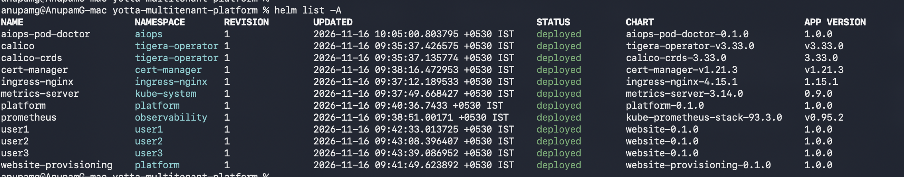

*Every pod is Running* (`kubectl get pod -A`): each tenant namespace has two app replicas and its own PostgreSQL; the platform, observability and add-on pods are healthy.

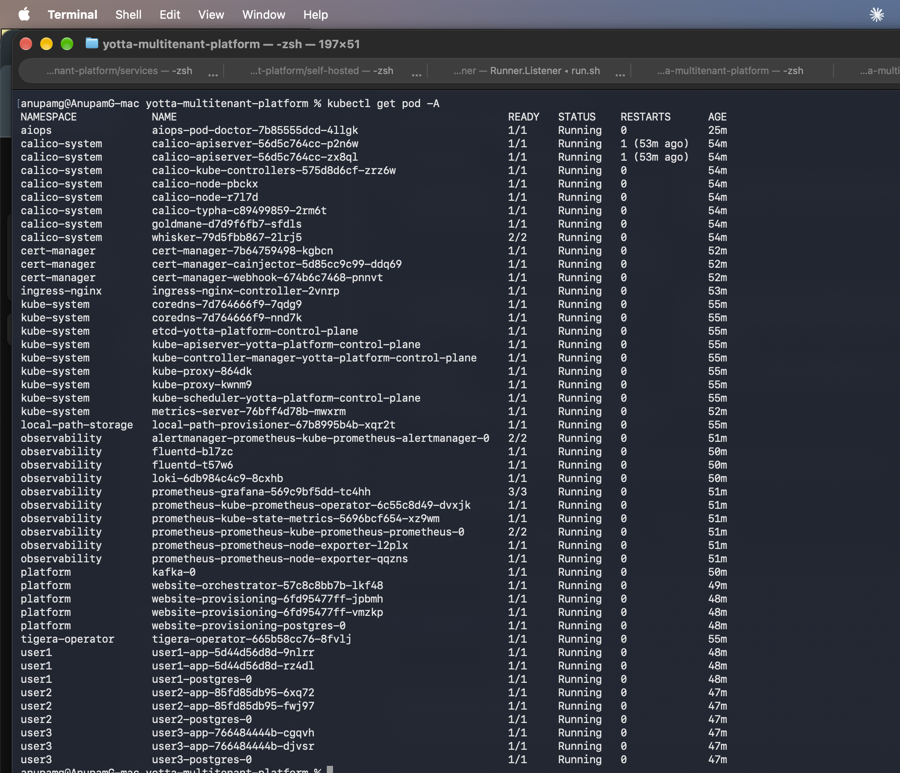

*HTTPS through the Ingress with TLS*: the provisioning API and user1 report ready (user1 checked its own database) and user1 serves its API.

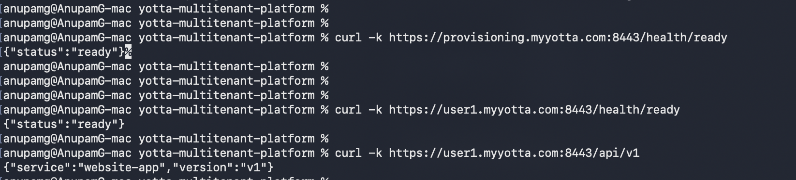

Still to add: browser tabs for the three tenants; the `user4` request and its CD run.

## 2. Scaling under load

**Show:** the HPA adds pods when CPU rises and removes them afterwards.

```sh
kubectl get hpa -n user1 -w                                     # terminal 1
python3 scripts/load_test.py --tenant user1 --seconds 180 --workers 40   # terminal 2
```

**Expect:** `REPLICAS` goes from 2 towards 8 (the chart's `maxReplicas`) while `cpu: x%/60%` is above
target; `kubectl describe hpa -n user1` lists `SuccessfulRescale` events. In `2-scaling.txt` the
15-second samples show the climb.

**Screenshots**

*HPA scaling out under load*: right, `scripts/load_test.py` sends CPU-heavy requests to user1 (40 workers, 180 s);
left, `kubectl get hpa -n user1 -w`. Idle at `cpu: 3–5%/60%` with 2 replicas; under load CPU jumps to 181 % and then
892 % of the request, and the HPA raises user1 from **2 to 6 replicas** within about a minute.

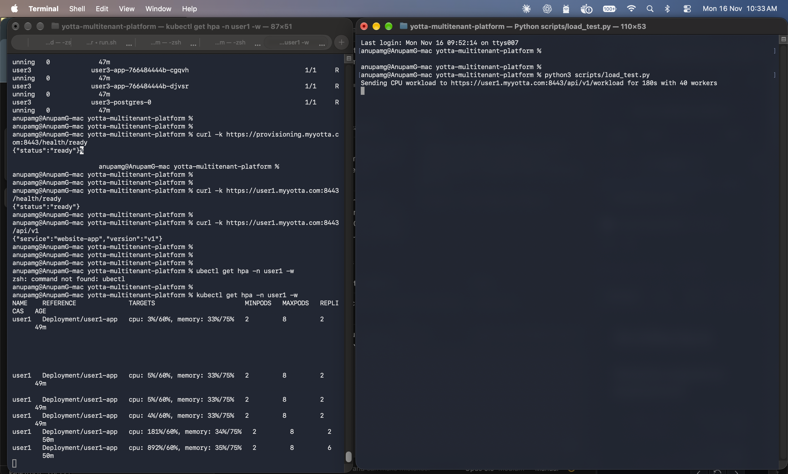

*Full scaling cycle*: the load test completed **22,585 requests with 0 failures**. The HPA went 2 → 6 → **8 replicas
(the maximum)** while CPU stayed above target, then, after the load ended and the 2-minute stabilisation window passed,
scaled back in to 4 (scale-in continues in steps of at most 50 % per minute), with no failed requests throughout.

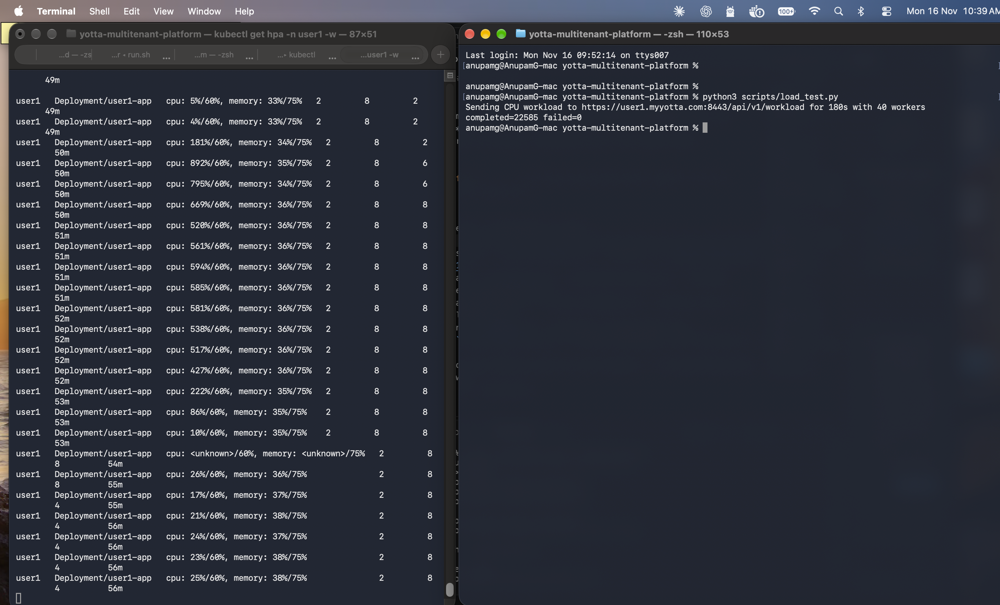

*Grafana during the load*: the request rate for user1 rises from 0 to about 75 requests/s at 10:36, every response
is HTTP 200, and the success rate stays at 100 %.

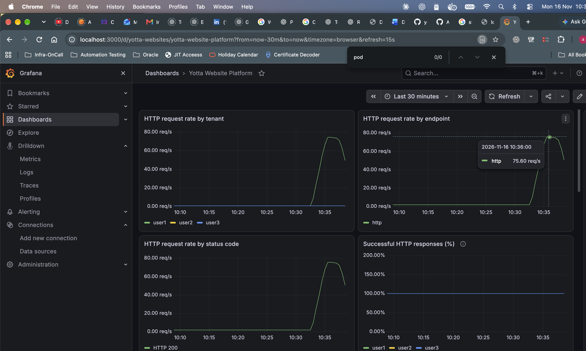

Still to add: the panels "Website replicas: current and desired" and "Website CPU usage by tenant" (lower on the same dashboard).

## 3. CI/CD with rollback and events

**Show:** CI validates and publishes a versioned image, CD waits for approval and deploys with Helm,
a failed deploy rolls back automatically and sends a `WebsiteDeploymentFailed` event.

1. **CI:** any push → Actions shows Website App CI green; its summary shows the image tag
   (`1.0.0-YYYYMMDDHHMMSS`).
2. **CD with approval:** run *Website App Deployment* (`tenant=user1`, `domain=user1.myyotta.com`) → **Review deployments** → approve.
3. **Rollback:** run it again with **simulate_failure = true**:
   ```sh
   gh workflow run website_app_cd.yml --ref master -f tenant=user1 -f domain=user1.myyotta.com -f simulate_failure=true
   ```
   The release is deployed with a readiness probe that can never pass. After 2 minutes Helm rolls back,
   the job publishes `WebsiteDeploymentFailed` and fails (red, as it should). user1 keeps serving throughout.

**Expect:**
```sh
helm history user1 -n user1
# REVISION  STATUS      DESCRIPTION
# 5         superseded  Upgrade complete
# 6         failed      Upgrade "user1" failed: context deadline exceeded
# 7         superseded  Rollback to 5      <- Helm's own --rollback-on-failure
# 8         deployed    Rollback to 5      <- the deploy script's safety-net rollback (same good revision)
curl -k https://user1.myyotta.com:8443/health/ready      # still {"status":"ready"}
```
The run's artifact `website-deployment-evidence-<run id>` contains `user1-helm-history.txt` and `user1-events.txt`.

**Screenshots**

*All pipelines in one place*: one CI and one CD workflow per component plus the shared Service CI; recent runs
on `master` are green (pushes run CI, CD runs are started manually).

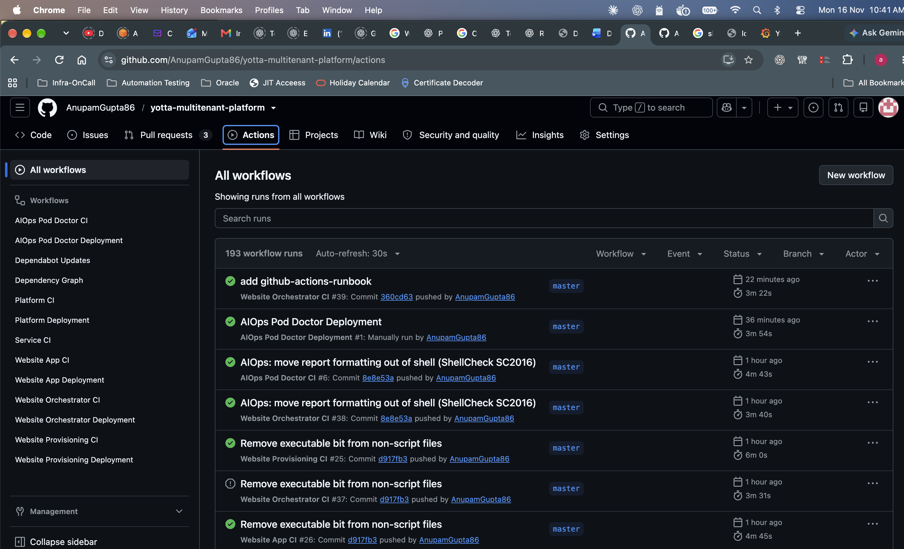

*CI stages*: each service runs chart validation (lint, schema, security scan), then `validate` (lint, unit tests,
Bandit, pip-audit, Gitleaks "No leaks detected", hadolint, image build, Trivy, container health check), then
`publish` to GHCR. Website Orchestrator CI also runs a real Kafka integration check.

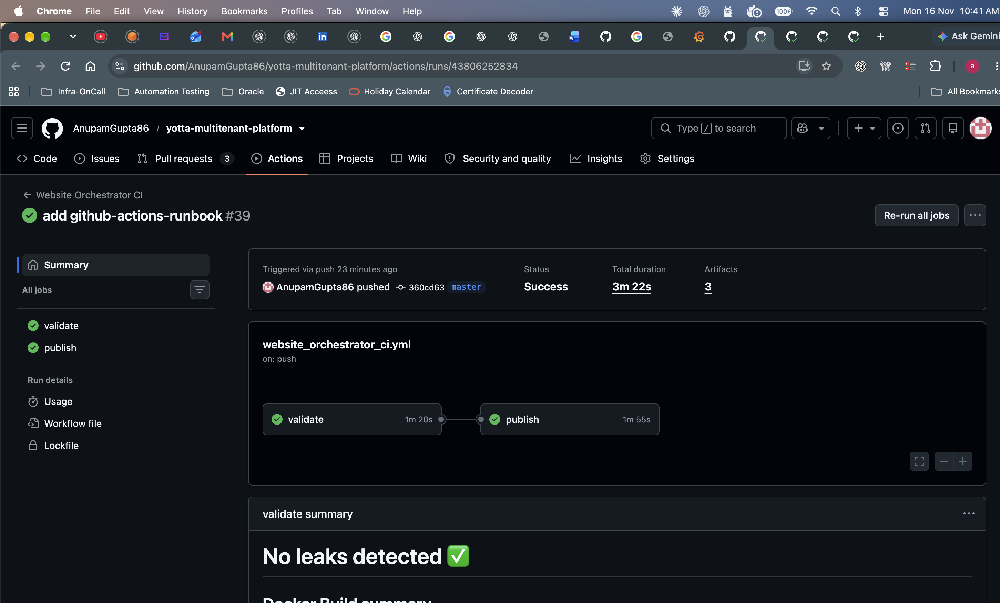
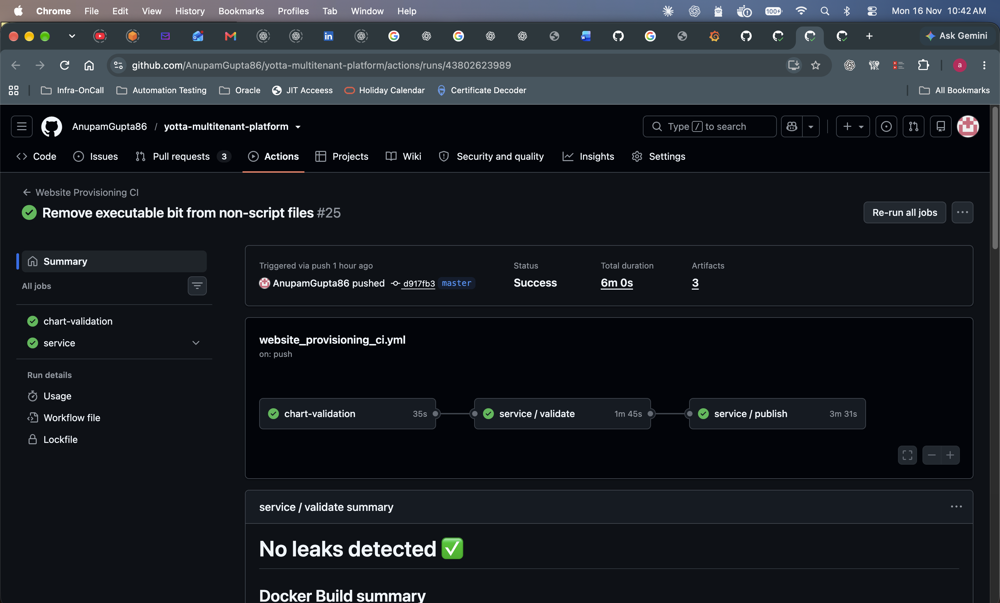
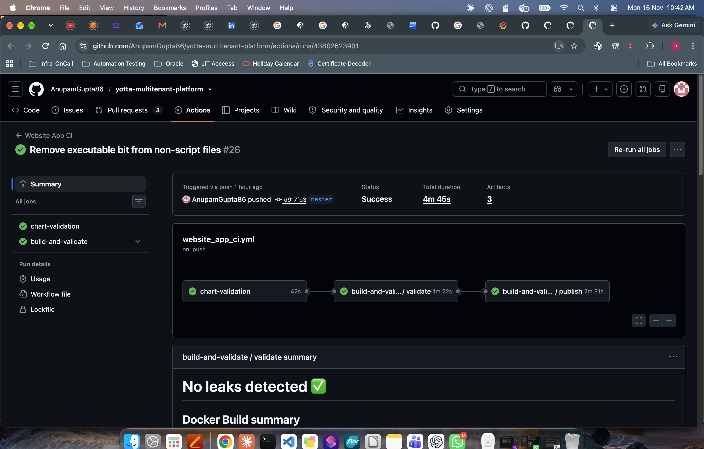

*Versioned images*: every publish writes the deployable tag `1.0.0-YYYYMMDDHHMMSS` and the full GHCR image to the
run summary; that tag is the CD input.

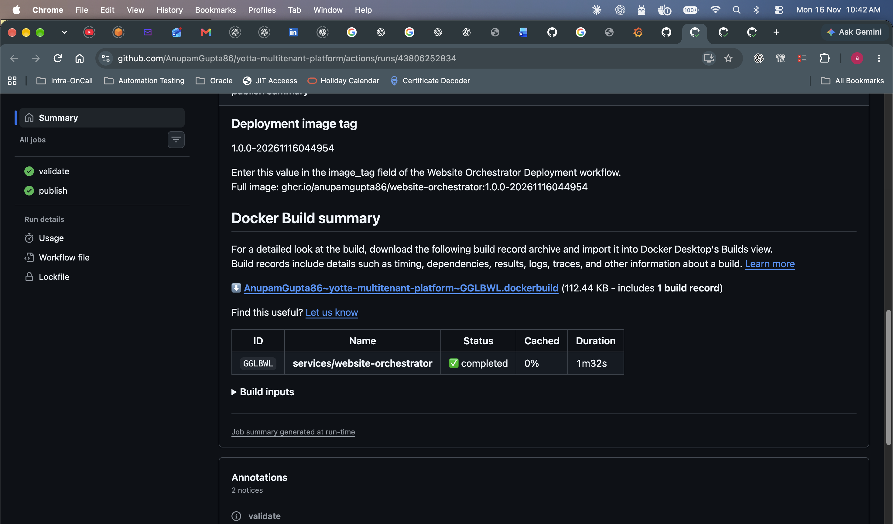
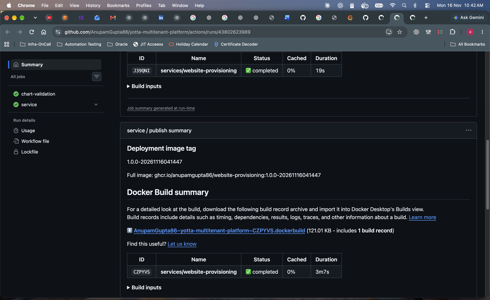
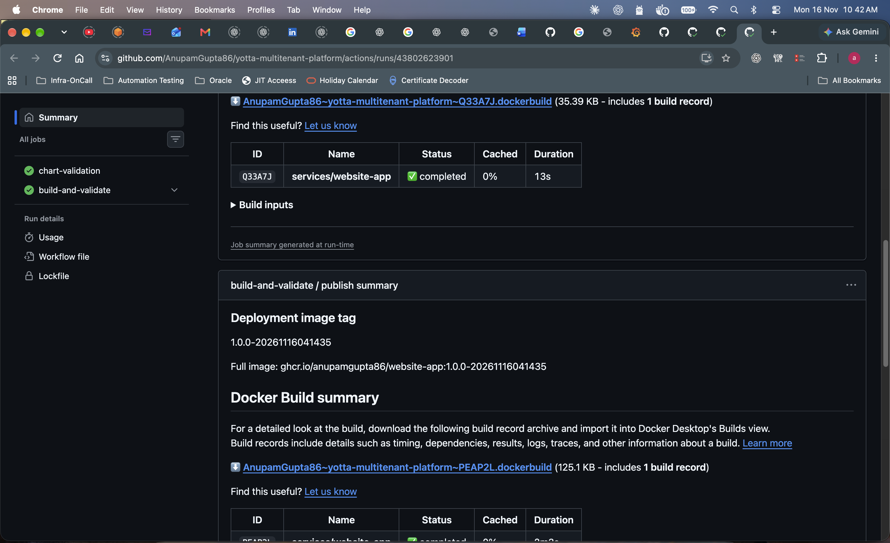

*CD history*: manual deployments of the provisioning API, the orchestrator and tenant websites. The early red runs
are from setting up the self-hosted runner (wrong tag, missing secret, runner Python); every later run is green.

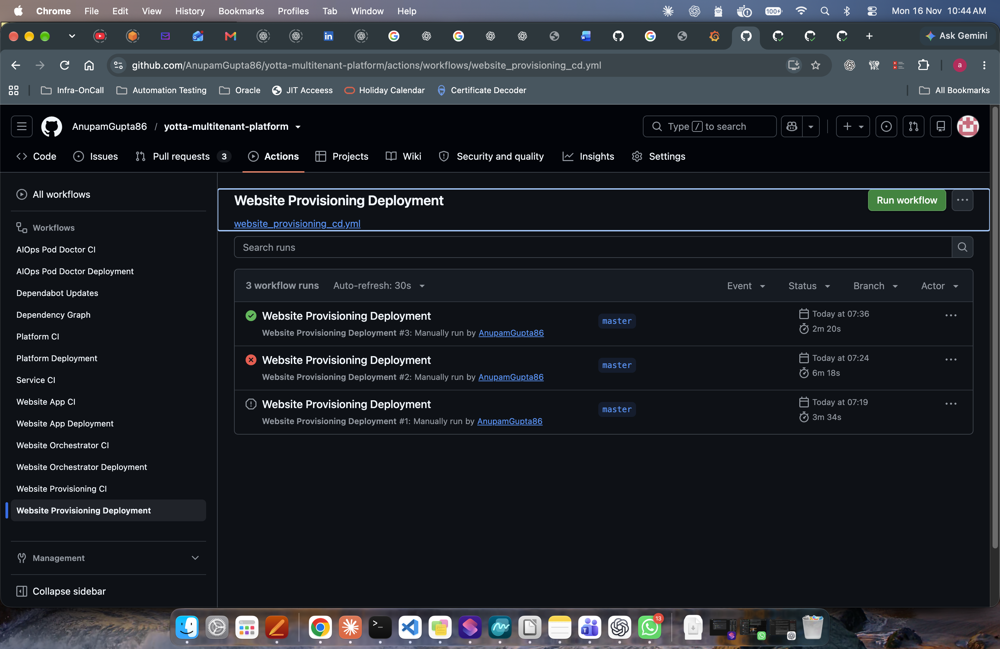
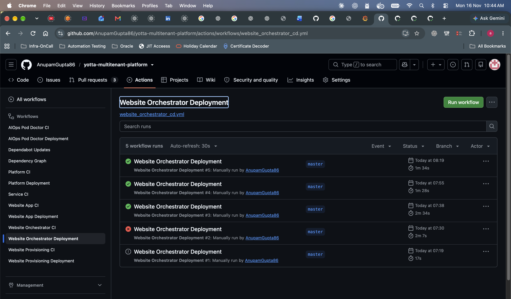
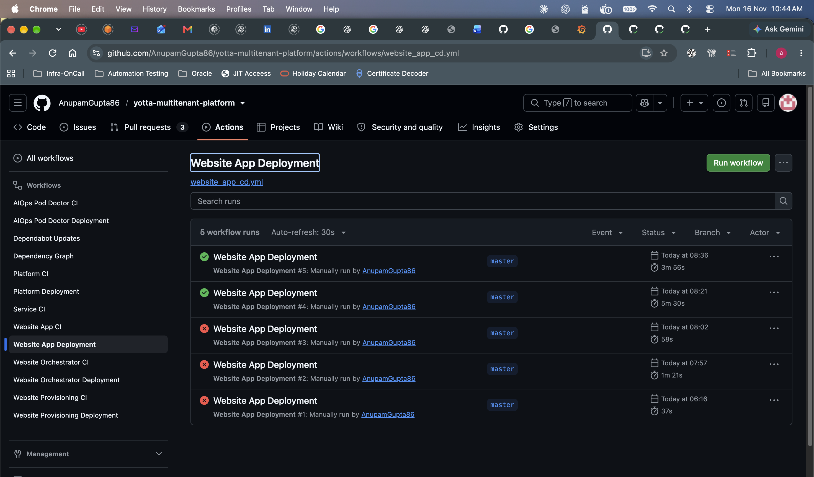

Still to add: the **Review deployments** approval dialog, the red `simulate_failure=true` run (with the
"Publish deployment failure event" step), and `helm history user1 -n user1` showing the rollback.

## 4. Kafka integration

**Show:** requests and deployment outcomes travel through Kafka, and every event was consumed.

```sh
kubectl exec -n platform kafka-0 -- /opt/kafka/bin/kafka-console-consumer.sh \
  --bootstrap-server localhost:19092 --topic website-events --from-beginning --timeout-ms 10000
kubectl exec -n platform kafka-0 -- /opt/kafka/bin/kafka-consumer-groups.sh \
  --bootstrap-server localhost:19092 --describe --all-groups
kubectl logs -n platform deploy/website-orchestrator --tail=50
```

**Expect:** JSON events `WebsiteProvisioningRequested`, `WebsiteCreated` (and `WebsiteDeploymentFailed`
from the rollback demo) linked by the same `correlation_id`; consumer group `website-orchestrator`
with `LAG 0`; orchestrator log lines for "dispatched workflow" and the readable notifications.

## 5. Observability dashboards

**Show:** Prometheus scrapes cluster and website metrics, Grafana shows them, Fluentd ships logs to Loki.

```sh
kubectl port-forward -n observability svc/prometheus-grafana 3000:80                        # Grafana: http://localhost:3000 (admin / password in helm/monitoring/values.yaml)
kubectl port-forward -n observability svc/prometheus-kube-prometheus-prometheus 9090:9090   # Prometheus: http://localhost:9090
```

**Expect:** dashboard *Yotta Website Platform* with request rate by tenant/endpoint/status, success %,
replicas (HPA), CPU, memory, restarts and database readiness per tenant; the standard
*Kubernetes / Compute Resources* dashboards; **Explore → Loki** with `{namespace="user1"}` returns app logs.

**Screenshots**

*Grafana, Yotta Website Platform dashboard*: the whole load test is visible: user1's request rate climbs from 0 to
about 75 requests/s at 10:33, holds, and drops back after 10:39; every response is HTTP 200 and the success rate
stays at 100 % throughout.

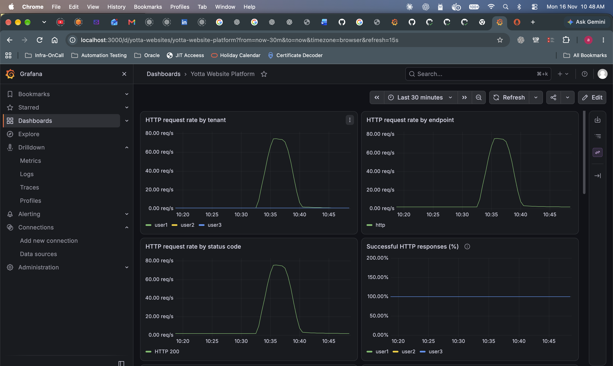

*Prometheus scrape targets* (`sum by (job) (up)`): every tenant is scraped through its ServiceMonitor (`user1`,
`user2`, `user3` = 2 each, one per app replica), together with the Kubernetes API, kubelet, kube-state-metrics,
node-exporter, CoreDNS, Grafana, Alertmanager and Prometheus itself.

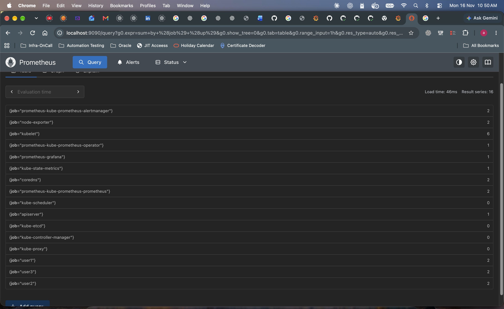

Still to add: a Loki log search (Grafana → Explore → Loki, `{namespace="user1"}`).

---

### Extra: AIOps pod doctor

`gh workflow run aiops_pod_doctor_cd.yml --ref master -f image_tag=<tag> -f demo_failure=crash` breaks a demo
pod and puts Grok's root cause and workaround into the run summary. See [aiops-pod-doctor/README.md](../aiops-pod-doctor/README.md).

*CI*: chart validation (with ShellCheck on the scripts) → validate (tests, scans, "No leaks detected") → publish,
which writes the deployable tag (`1.0.0-20261116041814`).

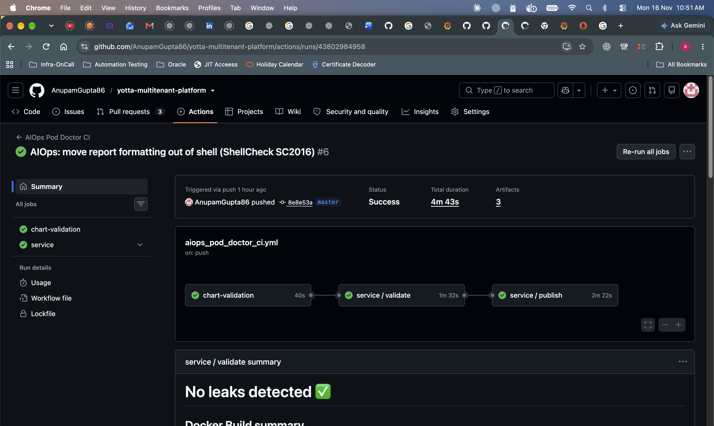
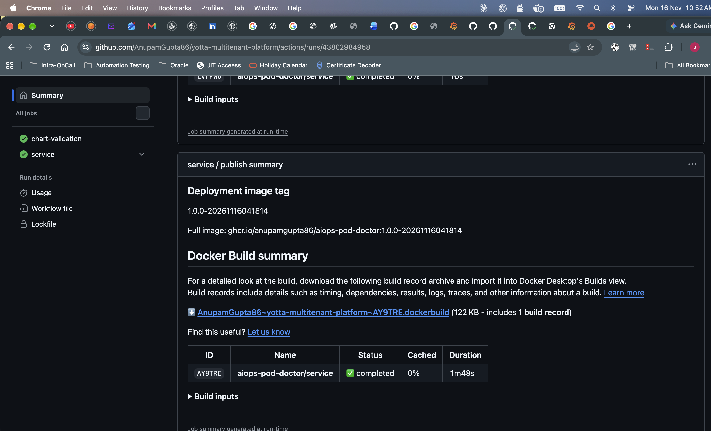

*CD with the negative test*: after approval the doctor is deployed, a demo pod is deliberately broken
(`aiops-demo/broken-crash`, CrashLoopBackOff), and the doctor's report appears in the run summary within the
3-minute window: run green in 3m 54s.

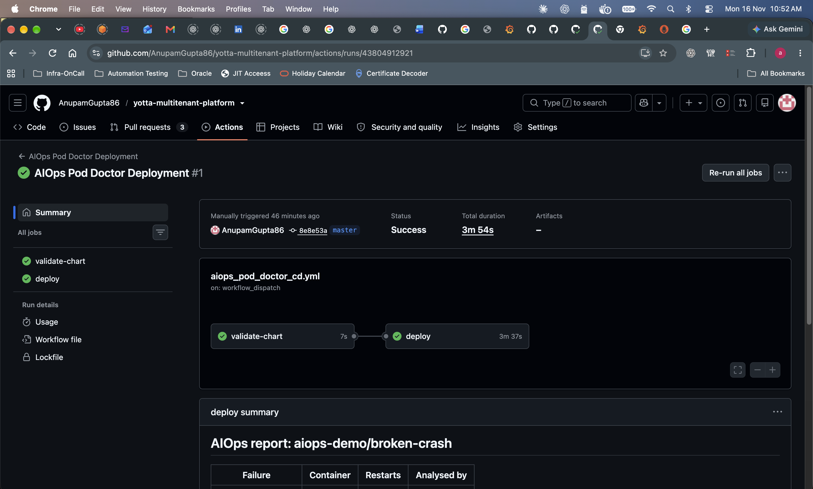

Still to add: the full report text below that table (Root cause, Evidence, Workaround now, Permanent fix).

Earlier validation reports are kept in [docs/history/](history/).
