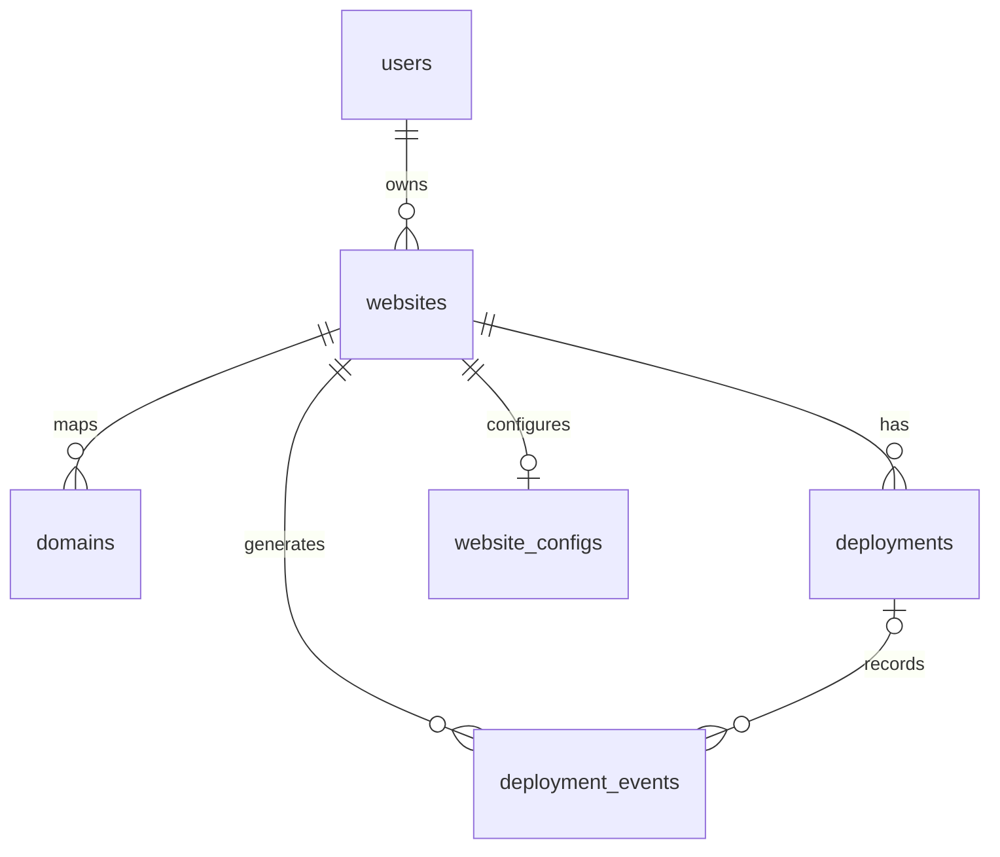

# myyotta PostgreSQL database

## Architecture

A single PostgreSQL 16 instance runs as a Kubernetes StatefulSet in the `platform-data` namespace. A ClusterIP Service named `postgresql` exposes TCP 5432 internally. A 5Gi ReadWriteOnce PVC stores database files. The schema is built into the image (`services/database/Dockerfile`) and runs on the first start.

This is an assignment-sized, single-instance deployment: it does not provide HA, replication, automated backups, or production-grade secret management.

## Names

| Item | Value |
|---|---|
| Platform | myyotta |
| Database | `myyotta_platform` |
| User | `myyotta_app` |
| Namespace | `platform-data` |
| Helm release | `myyotta-postgresql` |
| Service | `postgresql` |
| Port | `5432` |

**Namespace note:** The supplied task contains a conflict: its naming table says `myyotta-data-plane`, while its deployment, DNS, and API examples consistently use `platform-data`. This implementation follows `platform-data` consistently. Change the namespace in commands and connection settings together if the assignment owner confirms the other value.

## Tables and relationships

- `users`: customer accounts.
- `websites`: websites owned by users; `(user_id, website_name)` is unique.
- `domains`: platform and custom domain mappings for websites.
- `deployments`: deployment history for websites.
- `website_configs`: one resource/autoscaling configuration per website.
- `deployment_events`: lifecycle and Kafka publication event records.

Relationship summary: users 1-to-many websites; websites 1-to-many domains and deployments; websites 1-to-1 website_configs; websites 1-to-many deployment_events; deployments 1-to-many deployment_events (event deployment reference is nullable).



## Schema rules

| Rule | How |
|---|---|
| UUID primary keys | `gen_random_uuid()` (pgcrypto, enabled by `001_extensions.sql`) |
| Unique | `users.email`, `users.username`, `websites.namespace`, `(user_id, website_name)`, `domains.domain_name`, one `website_configs` row per website, one `PLATFORM` domain per website |
| ON DELETE | user → websites **RESTRICT** (deprovision websites first, so history is never deleted by accident); website → domains, deployments, config, events **CASCADE**; deployment → events **SET NULL** (events kept) |
| CHECK | replicas `1 ≤ min ≤ max ≤ 50`; CPU/memory targets `1-100`; CPU/memory as Kubernetes quantities (`500m`, `256Mi`); allowed `status` / type values; namespace is a valid DNS label; e-mail and domains lower-case |
| Timestamps | `created_at` / `updated_at` default `now()`; a trigger refreshes `updated_at` on every UPDATE |
| Indexes | every foreign key; `(website_id, created_at DESC)` for deployment and event history; website status; events still pending publication |
| Data | no sample users or rows |

`test/schema_test.sql` proves every rule above (26 checks) in one transaction that is rolled back.
CI runs it in the built image, CD runs it again in the deployed pod.

## Image (Dockerfile) and initialization

`services/database/init/` is the only copy of the schema. The `Dockerfile` builds on `postgres:16`, copies the
scripts into `/docker-entrypoint-initdb.d/`, sets `POSTGRES_DB=myyotta_platform` and `POSTGRES_USER=myyotta_app`
from the naming list, removes `gosu` and runs as the `postgres` user (uid 999). The password is never in the
image: it comes from the Kubernetes Secret at run time.

The official entrypoint runs the scripts in name order (001 ... 008) **only when the data directory is empty**,
that is on the first install. Existing data is reused on later starts, so the scripts are a bootstrap, not a
migration tool: change an existing database with a migration script, or recreate the PVC in a lab.

## Deploy

**With the pipelines** (recommended): push → **Database CI** builds, tests and publishes the image and prints its
tag → **Database Deployment** with that tag → read the Helm diff in *review-changes* → approve. The run summary
shows the tables and resources. Every value comes from `.github/pipeline-config.env` (`DATABASE_*`).

**By hand** (local image, from the repository root):

```bash
docker build -t myyotta-postgresql:local services/database
kind load docker-image myyotta-postgresql:local --name yotta-platform
helm upgrade --install myyotta-postgresql helm/database-helm --namespace platform-data --create-namespace --wait
```

The chart creates the Secret `myyotta-postgresql-secret` with a random 32-character password on the first install,
reuses it on every upgrade and keeps it on uninstall (`helm.sh/resource-policy: keep`), so it always matches the
data on the volume. To use your own password instead: `kubectl create secret generic myyotta-postgresql-secret
-n platform-data --from-literal=POSTGRES_PASSWORD=...` and install with `--set secret.create=false`.

If the cluster has no default StorageClass (`kubectl get storageclass`), add `--set persistence.storageClass=<name>`.

Only pods in `platform-data`, and pods labelled `myyotta.io/database-client: "true"` in any namespace, may
connect (NetworkPolicy). The provisioning API, the orchestrator and every tenant website carry that label.

## Verify Kubernetes resources

```bash
kubectl get pods,statefulsets,pvc,svc -n platform-data
kubectl get pv
kubectl logs statefulset/myyotta-postgresql -n platform-data
kubectl describe pod myyotta-postgresql-0 -n platform-data
```

Expected: one Ready PostgreSQL Pod, a Bound PVC, and a ClusterIP Service on 5432.

## Connect with psql

```bash
kubectl exec -it -n platform-data myyotta-postgresql-0 -- \
  psql -U myyotta_app -d myyotta_platform
```

Inside psql:

```sql
SELECT current_database();
\dt
\d users
```

## Basic INSERT and SELECT

```sql
INSERT INTO users (username, email, password_hash)
VALUES ('testuser', 'test@example.com', 'sample_hash')
RETURNING user_id, username, email;

SELECT user_id, username, email FROM users;
```

Example website insert using the user's ID:

```sql
INSERT INTO websites (user_id, website_name, namespace)
SELECT user_id, 'My Test Website', 'myyotta-test-website'
FROM users
WHERE email = 'test@example.com'
RETURNING *;
```

## Who uses the database

| Service (namespace) | Reads / writes |
|---|---|
| Provisioning API (`platform`) | `users` (register), `websites`, `domains`, `website_configs`, `deployment_events` (requests and deletions) |
| Website orchestrator (`platform`) | `deployments`, `deployment_events`, `websites.status` (PROVISIONING / ACTIVE / FAILED), removes a website after teardown |
| Tenant websites (`<tenant>`) | readiness check only (tenants no longer have their own PostgreSQL) |

Each service gets the connection from these environment variables (set by its Helm chart):

```text
DB_HOST=postgresql.platform-data.svc.cluster.local
DB_PORT=5432
DB_NAME=myyotta_platform
DB_USER=myyotta_app
DB_PASSWORD=<from Secret myyotta-postgresql-secret, key POSTGRES_PASSWORD>
```

Secrets are only readable in their own namespace, so `scripts/copy-database-secret.sh <namespace>` copies the
password Secret from `platform-data` into `platform` (Database, Platform, Orchestrator and Provisioning CD do it)
and into each tenant namespace (`deploy-tenant.sh` does it).

## Persistence test

Insert a row, delete the Pod, wait for the StatefulSet to recreate it, then query the row again:

```bash
kubectl delete pod myyotta-postgresql-0 -n platform-data
kubectl get pods -n platform-data -w
kubectl exec -it -n platform-data myyotta-postgresql-0 -- \
  psql -U myyotta_app -d myyotta_platform \
  -c "SELECT * FROM users WHERE email='test@example.com';"
kubectl get pvc -n platform-data
```

Do not delete the PVC for this test. The PVC template has a Helm keep annotation to reduce accidental removal on uninstall; retained PVCs may need manual cleanup.

## Backup example

This writes a logical SQL dump to the machine running kubectl:

```bash
kubectl exec -n platform-data myyotta-postgresql-0 -- \
  pg_dump -U myyotta_app myyotta_platform > myyotta_backup.sql
```

This is a manual example, not automated backup infrastructure.

## Troubleshooting

```bash
kubectl get pods,pvc,svc -n platform-data
kubectl describe pod myyotta-postgresql-0 -n platform-data
kubectl logs myyotta-postgresql-0 -n platform-data
kubectl describe pvc myyotta-postgresql-data -n platform-data
helm status myyotta-postgresql -n platform-data
helm get manifest myyotta-postgresql -n platform-data
```

Common checks:
- PVC Pending: inspect StorageClasses and provisioner events.
- Pod CrashLoopBackOff: inspect PostgreSQL logs and Secret key/name.
- Init scripts did not run: they run only on an empty data volume (first install). Check the image has them: `kubectl exec -n platform-data myyotta-postgresql-0 -- ls /docker-entrypoint-initdb.d`.
- Connection refused: check Pod readiness, Service endpoints, namespace, and port.
