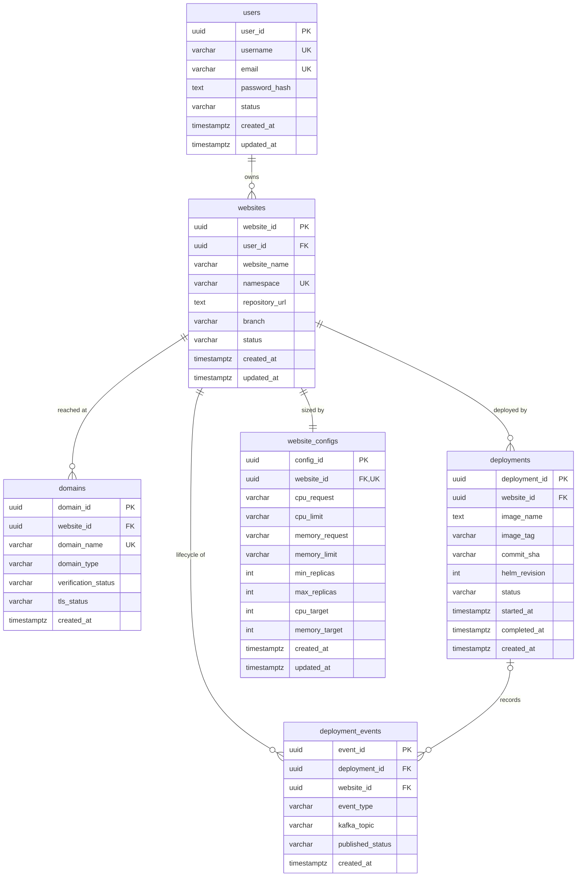
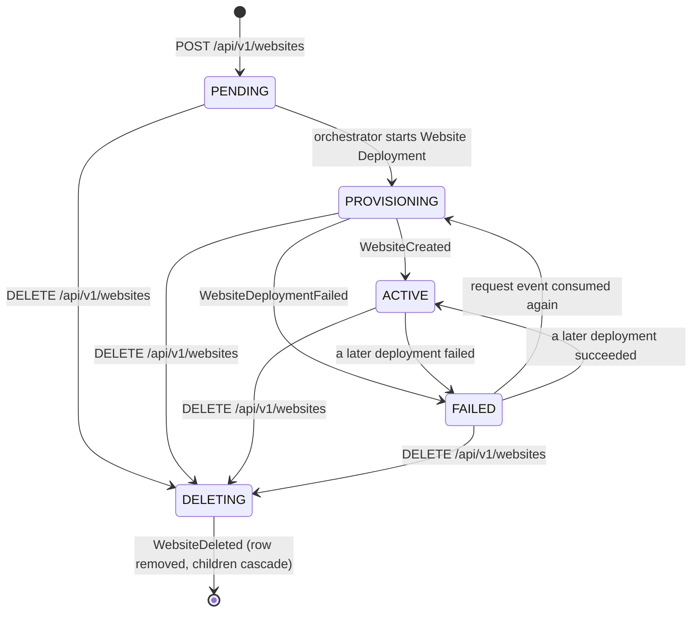

# myyotta PostgreSQL database

## Architecture

A single PostgreSQL 16 instance runs as a Kubernetes StatefulSet in the `platform-data` namespace. A ClusterIP Service named `postgresql` exposes TCP 5432 internally. A 5Gi ReadWriteOnce PVC stores database files. The schema is built into the image (`services/database/Dockerfile`) and runs on the first start.

This is an assignment-sized, single-instance deployment: it does not provide HA, replication, automated backups, or production-grade secret management.

## Names

| Item | Value |
|---|---|
| Platform | myyotta |
| Database | `myyotta_platform` |
| User | `myyotta_app` |
| Namespace | `platform-data` |
| Helm release | `myyotta-postgresql` |
| Service | `postgresql` |
| Port | `5432` |

**Namespace note:** The supplied task contains a conflict: its naming table says `myyotta-data-plane`, while its deployment, DNS, and API examples consistently use `platform-data`. This implementation follows `platform-data` consistently. Change the namespace in commands and connection settings together if the assignment owner confirms the other value.

## Database design

One shared database, `myyotta_platform`, holds the state of the whole platform: who the customers are,
which websites they own, how each website is reached and sized, and what happened to it. Tenant websites keep no
data of their own; isolation between tenants is done in Kubernetes (namespace, NetworkPolicy, quota).

Design choices:

- **UUID keys** (`gen_random_uuid()`): IDs can be created by any service and appear in Kafka events without
  revealing counts or order.
- **One row per website, one namespace per website**: `websites.namespace` is the tenant name used for the
  Kubernetes namespace and the Helm release, so the database and the cluster can always be matched.
- **History is append-only**: every deployment and lifecycle event is a new row (`deployments`,
  `deployment_events`); the current state is `websites.status`.
- **The database enforces the rules** (foreign keys, `UNIQUE`, `CHECK`), not only the services: a bug or a manual
  `psql` session cannot store an invalid namespace, a second platform domain, or replicas outside 1–50.
- **Safe deletes**: deleting a user with websites is refused (RESTRICT); deleting a website removes everything
  that belongs to it (CASCADE); deleting a deployment keeps its events (SET NULL).
- **Idempotent event handling**: the Kafka `event_id` is the `deployment_events` primary key, so a message
  that is delivered twice is recorded once.

### Entity-relationship diagram



| Relationship | Cardinality | On delete of the parent |
|---|---|---|
| `users` → `websites` | 1 to many | **RESTRICT**: refused while the user owns websites |
| `websites` → `domains` | 1 to many (at most one `PLATFORM` domain) | CASCADE |
| `websites` → `deployments` | 1 to many | CASCADE |
| `websites` → `website_configs` | 1 to 1 | CASCADE |
| `websites` → `deployment_events` | 1 to many | CASCADE |
| `deployments` → `deployment_events` | 0..1 to many (optional link) | SET NULL: events are kept |

### Table structure

#### `users` (002_create_users.sql)

| Column | Type | Null | Default | Key / notes |
|---|---|---|---|---|
| `user_id` | `UUID` | no | `gen_random_uuid()` | PK |
| `username` | `VARCHAR(100)` | no |  | unique |
| `email` | `VARCHAR(255)` | no |  | unique; stored lower-case; must contain `@` |
| `password_hash` | `TEXT` | no |  | salted scrypt hash (`scrypt$n$r$p$salt$hash`); never returned by the API |
| `status` | `VARCHAR(20)` | no | `'ACTIVE'` | `ACTIVE`, `SUSPENDED`, `DELETED` |
| `created_at` | `TIMESTAMPTZ` | no | `now()` |  |
| `updated_at` | `TIMESTAMPTZ` | no | `now()` |  |

#### `websites` (003_create_websites.sql)

| Column | Type | Null | Default | Key / notes |
|---|---|---|---|---|
| `website_id` | `UUID` | no | `gen_random_uuid()` | PK |
| `user_id` | `UUID` | no |  | FK → `users.user_id` (RESTRICT); owner |
| `website_name` | `VARCHAR(150)` | no |  | unique per owner (`user_id`, `website_name`) |
| `namespace` | `VARCHAR(63)` | no |  | unique; tenant name = Kubernetes namespace = Helm release; valid DNS label |
| `repository_url` | `TEXT` | yes |  | reserved for per-website source repos (not used yet) |
| `branch` | `VARCHAR(100)` | no | `'main'` |  |
| `status` | `VARCHAR(30)` | no | `'PENDING'` | `PENDING`, `PROVISIONING`, `ACTIVE`, `FAILED`, `SUSPENDED`, `DELETING` |
| `created_at` | `TIMESTAMPTZ` | no | `now()` |  |
| `updated_at` | `TIMESTAMPTZ` | no | `now()` |  |

#### `domains` (004_create_domains.sql)

| Column | Type | Null | Default | Key / notes |
|---|---|---|---|---|
| `domain_id` | `UUID` | no | `gen_random_uuid()` | PK |
| `website_id` | `UUID` | no |  | FK → `websites.website_id` (CASCADE) |
| `domain_name` | `VARCHAR(253)` | no |  | lower-case hostname, unique across all websites |
| `domain_type` | `VARCHAR(20)` | no | `'PLATFORM'` | `PLATFORM` (one per website) or `CUSTOM` |
| `verification_status` | `VARCHAR(30)` | no | `'PENDING'` | `PENDING`, `VERIFIED`, `FAILED` |
| `tls_status` | `VARCHAR(30)` | no | `'PENDING'` | `PENDING`, `ISSUED`, `FAILED`, `EXPIRED` |
| `created_at` | `TIMESTAMPTZ` | no | `now()` |  |

#### `deployments` (005_create_deployments.sql)

| Column | Type | Null | Default | Key / notes |
|---|---|---|---|---|
| `deployment_id` | `UUID` | no | `gen_random_uuid()` | PK |
| `website_id` | `UUID` | no |  | FK → `websites.website_id` (CASCADE) |
| `image_name` | `TEXT` | no |  |  |
| `image_tag` | `VARCHAR(150)` | no |  |  |
| `commit_sha` | `VARCHAR(64)` | yes |  |  |
| `helm_revision` | `INTEGER` | yes |  | > 0 when set |
| `status` | `VARCHAR(30)` | no | `'PENDING'` | `PENDING`, `IN_PROGRESS`, `SUCCEEDED`, `FAILED`, `ROLLED_BACK` |
| `started_at` | `TIMESTAMPTZ` | yes |  |  |
| `completed_at` | `TIMESTAMPTZ` | yes |  | ≥ `started_at` |
| `created_at` | `TIMESTAMPTZ` | no | `now()` |  |

#### `website_configs` (006_create_website_configs.sql)

| Column | Type | Null | Default | Key / notes |
|---|---|---|---|---|
| `config_id` | `UUID` | no | `gen_random_uuid()` | PK |
| `website_id` | `UUID` | no |  | FK → `websites.website_id` (CASCADE); unique: one config per website |
| `cpu_request` | `VARCHAR(30)` | no | `'50m'` | Kubernetes quantity (`50m`, `0.5`) |
| `cpu_limit` | `VARCHAR(30)` | no | `'500m'` |  |
| `memory_request` | `VARCHAR(30)` | no | `'128Mi'` | Kubernetes quantity (`128Mi`, `1Gi`) |
| `memory_limit` | `VARCHAR(30)` | no | `'256Mi'` |  |
| `min_replicas` | `INTEGER` | no | `1` | 1 ≤ min ≤ max ≤ 50 |
| `max_replicas` | `INTEGER` | no | `8` |  |
| `cpu_target` | `INTEGER` | no | `60` | HPA target, % of the CPU request (1–100) |
| `memory_target` | `INTEGER` | no | `75` | HPA target, % of the memory request (1–100) |
| `created_at` | `TIMESTAMPTZ` | no | `now()` |  |
| `updated_at` | `TIMESTAMPTZ` | no | `now()` |  |

#### `deployment_events` (007_create_deployment_events.sql)

| Column | Type | Null | Default | Key / notes |
|---|---|---|---|---|
| `event_id` | `UUID` | no | `gen_random_uuid()` | PK; same ID as the Kafka message `event_id` |
| `deployment_id` | `UUID` | yes |  | FK → `deployments.deployment_id` (SET NULL); nullable; SET NULL when the deployment is deleted |
| `website_id` | `UUID` | no |  | FK → `websites.website_id` (CASCADE) |
| `event_type` | `VARCHAR(100)` | no |  | e.g. `WebsiteProvisioningRequested`, `WebsiteCreated` |
| `kafka_topic` | `VARCHAR(255)` | no | `'website-events'` |  |
| `published_status` | `VARCHAR(30)` | no | `'PENDING'` | `PENDING`, `PUBLISHED`, `FAILED` (Kafka publication) |
| `created_at` | `TIMESTAMPTZ` | no | `now()` |  |

### Indexes

Primary keys and `UNIQUE` constraints have their own indexes. `008_create_indexes.sql` adds:

| Index | Columns | Used for |
|---|---|---|
| `idx_websites_user_id` | `websites (user_id)` | a user's websites; RESTRICT check when deleting a user |
| `idx_websites_status` | `websites (status)` | websites by state (dashboards, workers) |
| `idx_domains_website_id` | `domains (website_id)` | a website's domains; CASCADE delete |
| `idx_deployments_website_created` | `deployments (website_id, created_at DESC)` | latest deployment of a website (`GET /api/v1/websites`) |
| `idx_deployment_events_website_created` | `deployment_events (website_id, created_at DESC)` | event history of a website |
| `idx_deployment_events_deployment_id` | `deployment_events (deployment_id)` | SET NULL when a deployment is deleted |
| `idx_deployment_events_pending` | `deployment_events (created_at) WHERE published_status = 'PENDING'` | events not yet published to Kafka (partial index) |
| `uq_domains_one_platform_domain` | `domains (website_id) WHERE domain_type = 'PLATFORM'` | unique: one platform domain per website |

### Functions and triggers

| Object | Purpose |
|---|---|
| extension `pgcrypto` | `gen_random_uuid()` for all primary keys |
| function `set_updated_at()` | sets `updated_at = now()` on every UPDATE |
| triggers `trg_users_updated_at`, `trg_websites_updated_at`, `trg_website_configs_updated_at` | attach it to the three tables that have `updated_at` |

### Website lifecycle (`websites.status`)



Deployment outcomes (`WebsiteCreated`, `WebsiteDeploymentFailed`) set `ACTIVE` / `FAILED` from any state except
`DELETING`, so a website being torn down never comes back. `SUSPENDED` is allowed by the schema
for an operator to set by hand; no service sets it yet.

### What each event writes

| Step | Written by | Rows |
|---|---|---|
| `POST /api/v1/users/register` | Hosting Platform API | `users` (INSERT) |
| `POST /api/v1/websites` | Hosting Platform API, one transaction | `websites` (`PENDING`), `domains` (`PLATFORM`), `website_configs` (defaults), `deployment_events` (`WebsiteProvisioningRequested`, `PENDING` → `PUBLISHED` once Kafka accepts it, or `FAILED`) |
| `WebsiteProvisioningRequested` consumed | Website orchestrator | `websites.status` → `PROVISIONING` |
| `WebsiteCreated` / `WebsiteDeploymentFailed` consumed | Website orchestrator, one transaction | `deployments` (`SUCCEEDED` / `FAILED`, image and tag), `deployment_events` (the event, linked to that deployment), `websites.status` → `ACTIVE` / `FAILED` (unless `DELETING`) |
| `DELETE /api/v1/websites` | Hosting Platform API | `websites.status` → `DELETING`, `deployment_events` (`WebsiteDeletionRequested`) |
| `WebsiteDeleted` consumed | Website orchestrator | `websites` row deleted; its domains, config, deployments and events cascade |

### Useful queries

```sql
-- every website with owner, platform domain and last deployment
SELECT w.namespace, w.status, u.email, d.domain_name, last.status AS last_deploy, last.image_tag
FROM websites w
JOIN users u ON u.user_id = w.user_id
LEFT JOIN domains d ON d.website_id = w.website_id AND d.domain_type = 'PLATFORM'
LEFT JOIN LATERAL (SELECT status, image_tag FROM deployments
                   WHERE website_id = w.website_id ORDER BY created_at DESC LIMIT 1) last ON true
ORDER BY w.created_at;

-- event history of one website
SELECT e.created_at, e.event_type, e.published_status, dep.status AS deployment
FROM deployment_events e JOIN websites w USING (website_id)
LEFT JOIN deployments dep USING (deployment_id)
WHERE w.namespace = 'user2' ORDER BY e.created_at;

-- events that never reached Kafka
SELECT w.namespace, e.event_type, e.created_at FROM deployment_events e JOIN websites w USING (website_id)
WHERE e.published_status <> 'PUBLISHED';
```

## Schema rules

| Rule | How |
|---|---|
| UUID primary keys | `gen_random_uuid()` (pgcrypto, enabled by `001_extensions.sql`) |
| Unique | `users.email`, `users.username`, `websites.namespace`, `(user_id, website_name)`, `domains.domain_name`, one `website_configs` row per website, one `PLATFORM` domain per website |
| ON DELETE | user → websites **RESTRICT** (deprovision websites first, so history is never deleted by accident); website → domains, deployments, config, events **CASCADE**; deployment → events **SET NULL** (events kept) |
| CHECK | replicas `1 ≤ min ≤ max ≤ 50`; CPU/memory targets `1-100`; CPU/memory as Kubernetes quantities (`500m`, `256Mi`); allowed `status` / type values; namespace is a valid DNS label; e-mail and domains lower-case |
| Timestamps | `created_at` / `updated_at` default `now()`; a trigger refreshes `updated_at` on every UPDATE |
| Indexes | every foreign key; `(website_id, created_at DESC)` for deployment and event history; website status; events still pending publication |
| Data | no sample users or rows |

`test/schema_test.sql` proves every rule above (26 checks) in one transaction that is rolled back.
CI runs it in the built image, CD runs it again in the deployed pod.

## Image (Dockerfile) and initialization

`services/database/init/` is the only copy of the schema. The `Dockerfile` builds on `postgres:16`, copies the
scripts into `/docker-entrypoint-initdb.d/`, sets `POSTGRES_DB=myyotta_platform` and `POSTGRES_USER=myyotta_app`
from the naming list, removes `gosu` and runs as the `postgres` user (uid 999). The password is never in the
image: it comes from the Kubernetes Secret at run time.

The official entrypoint runs the scripts in name order (001 ... 008) **only when the data directory is empty**,
that is on the first install. Existing data is reused on later starts, so the scripts are a bootstrap, not a
migration tool: change an existing database with a migration script, or recreate the PVC in a lab.

## Deploy

**With the pipelines** (recommended): push → **Database CI** builds, tests and publishes the image and prints its
tag → **Database Deployment** with that tag → read the Helm diff in *review-changes* → approve. The run summary
shows the tables and resources. Every value comes from `.github/pipeline-config.env` (`DATABASE_*`).

**By hand** (local image, from the repository root):

```bash
docker build -t myyotta-postgresql:local services/database
kind load docker-image myyotta-postgresql:local --name yotta-platform
helm upgrade --install myyotta-postgresql helm/database-helm --namespace platform-data --create-namespace --wait
```

The chart creates the Secret `myyotta-postgresql-secret` with a random 32-character password on the first install,
reuses it on every upgrade and keeps it on uninstall (`helm.sh/resource-policy: keep`), so it always matches the
data on the volume. To use your own password instead: `kubectl create secret generic myyotta-postgresql-secret
-n platform-data --from-literal=POSTGRES_PASSWORD=...` and install with `--set secret.create=false`.

If the cluster has no default StorageClass (`kubectl get storageclass`), add `--set persistence.storageClass=<name>`.

Only pods in `platform-data`, and pods labelled `myyotta.io/database-client: "true"` in any namespace, may
connect (NetworkPolicy). The hosting-platform API, the orchestrator and every tenant website carry that label.

## Verify Kubernetes resources

```bash
kubectl get pods,statefulsets,pvc,svc -n platform-data
kubectl get pv
kubectl logs statefulset/myyotta-postgresql -n platform-data
kubectl describe pod myyotta-postgresql-0 -n platform-data
```

Expected: one Ready PostgreSQL Pod, a Bound PVC, and a ClusterIP Service on 5432.

## Connect with psql

```bash
kubectl exec -it -n platform-data myyotta-postgresql-0 -- \
  psql -U myyotta_app -d myyotta_platform
```

Inside psql:

```sql
SELECT current_database();
\dt
\d users
```

## Basic INSERT and SELECT

```sql
INSERT INTO users (username, email, password_hash)
VALUES ('testuser', 'test@example.com', 'sample_hash')
RETURNING user_id, username, email;

SELECT user_id, username, email FROM users;
```

Example website insert using the user's ID:

```sql
INSERT INTO websites (user_id, website_name, namespace)
SELECT user_id, 'My Test Website', 'myyotta-test-website'
FROM users
WHERE email = 'test@example.com'
RETURNING *;
```

## Who uses the database

| Service (namespace) | Reads / writes |
|---|---|
| Hosting Platform API (`platform`) | `users` (register), `websites`, `domains`, `website_configs`, `deployment_events` (requests and deletions) |
| Website orchestrator (`platform`) | `deployments`, `deployment_events`, `websites.status` (PROVISIONING / ACTIVE / FAILED), removes a website after teardown |
| Tenant websites (`<tenant>`) | readiness check only (websites keep no data of their own) |

Each service gets the connection from these environment variables (set by its Helm chart):

```text
DB_HOST=postgresql.platform-data.svc.cluster.local
DB_PORT=5432
DB_NAME=myyotta_platform
DB_USER=myyotta_app
DB_PASSWORD=<from Secret myyotta-postgresql-secret, key POSTGRES_PASSWORD>
```

Secrets are only readable in their own namespace, so `scripts/copy-database-secret.sh <namespace>` copies the
password Secret from `platform-data` into `platform` (Database, Website Orchestrator and Hosting Platform CD do it)
and into each tenant namespace (`deploy-tenant.sh` does it).

## Persistence test

Insert a row, delete the Pod, wait for the StatefulSet to recreate it, then query the row again:

```bash
kubectl delete pod myyotta-postgresql-0 -n platform-data
kubectl get pods -n platform-data -w
kubectl exec -it -n platform-data myyotta-postgresql-0 -- \
  psql -U myyotta_app -d myyotta_platform \
  -c "SELECT * FROM users WHERE email='test@example.com';"
kubectl get pvc -n platform-data
```

Do not delete the PVC for this test. The PVC template has a Helm keep annotation to reduce accidental removal on uninstall; retained PVCs may need manual cleanup.

## Backup example

This writes a logical SQL dump to the machine running kubectl:

```bash
kubectl exec -n platform-data myyotta-postgresql-0 -- \
  pg_dump -U myyotta_app myyotta_platform > myyotta_backup.sql
```

This is a manual example, not automated backup infrastructure.

## Troubleshooting

```bash
kubectl get pods,pvc,svc -n platform-data
kubectl describe pod myyotta-postgresql-0 -n platform-data
kubectl logs myyotta-postgresql-0 -n platform-data
kubectl describe pvc myyotta-postgresql-data -n platform-data
helm status myyotta-postgresql -n platform-data
helm get manifest myyotta-postgresql -n platform-data
```

Common checks:
- PVC Pending: inspect StorageClasses and provisioner events.
- Pod CrashLoopBackOff: inspect PostgreSQL logs and Secret key/name.
- Init scripts did not run: they run only on an empty data volume (first install). Check the image has them: `kubectl exec -n platform-data myyotta-postgresql-0 -- ls /docker-entrypoint-initdb.d`.
- Connection refused: check Pod readiness, Service endpoints, namespace, and port.
